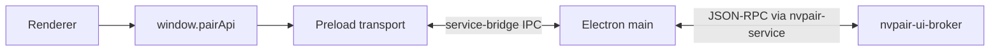

<!--
SPDX-FileCopyrightText: Copyright (c) 2026 NVIDIA CORPORATION & AFFILIATES. All rights reserved.
SPDX-License-Identifier: Apache-2.0
-->

# Frontend API

`pairApi.engines.setStatedMemory` and `clearStatedMemory` use
`engines:set-stated-memory` and `engines:clear-stated-memory`. Supply the applied
inspection's `configurationKey`, engine, model ID and optional target node ID.
Set supplies canonical decimal byte strings for exactly `configurationPools`:
`hostBytes`, `hostBytes` plus `deviceBytes`, or `sharedBytes`. Both return the
target inspection with current-first `memoryProfiles` (at most 8) and optional
`memoryProfilesUnavailable`. A stale key returns `-32010`: reinspect before
retrying. These advisory records do not change estimates or routing budgets.
Remote recording requires the target's management grant and is refused while
paused; local recording remains allowed while paused.

`window.windowApi.buildApply` exposes `choosePreview`, `start`, `status` and
`onChanged`. Electron owns the native picker and GUI facts; the service owns
validation and transaction admission. Start uses the selected preview and
explicit interruption consent. A stale or incomplete preview must be renewed;
production start currently refuses before Pause because `buildApplyOwners` is
nil. Operation status and uncertainty are retained rather than inferred from
a disconnected request.

`pairApi.engines.inspectModel({nodeId,engine,modelId})` invokes
`engines:inspect-model` and returns the target's artifact status/source/assurance,
bounded facts, option descriptors and advisory estimate. This is a read, usable
without activating an engine. Unavailable data remains unavailable. Engine
settings snapshots/previews also carry model loads, coupled state and explicit
runtime impact, so desired intent is not confused with an applied/observed state.
The model configuration panel uses the target preview and reviewed Apply for
selected manual load and policy changes. Production Auto/Fits remains unavailable
until complete-cost accounting is specified, implemented and accepted; connected
target telemetry and useful partial estimates do not establish completeness.
Apply retains the target's full settings baseline beside `modelChange`; copy
submits selected portable preferences for a fresh destination preview. Native
bindings, conversion provenance and build/source/preset digests remain target
authority. A receipt records an attempt, while the snapshot reports desired,
effective, coupled and observed state separately.

Inspection also returns optional service-owned `loadObservation`, describing
rounded native buffers and the frozen estimate for that captured load.
`parseInspectModel` strictly validates and detaches supplied summaries; a missing
wire field becomes `{status:'unknown',current:false,reason:'observation-omitted'}`.
Unknown/partial/unsupported results preserve ordinary inspection. Malformed
supplied summaries are refused rather than interpreted as missing. The transport
and existing `engines:inspect-model` channel remain unchanged.

`ModelSettingsPreview` renders `ModelLoadBufferReport` independently of the draft
estimate/Auto proposal. Target/model changes and stale inspection cannot assert
a current load. Authority invalidation, baseline change, disconnect and newer
Off snapshots withdraw currentness while preserving history. Local edit/discard
of a draft leaves a valid captured load unchanged. Reinspection uses the existing
explicit request owner, with no new poller/action. Reports never enter portable
copy, Apply, qualification or calibration. The
[buffer contract](../../docs/model-buffer-observations.mdx) describes rounding,
provenance, privacy and budgets. Windows process and native accuracy acceptance
remain pending; copy-family acceptance also awaits the separate copy fix.

The supported renderer service API is `window.pairApi`. It is available only in
Electron and is backed by the preload service bridge.

The source of truth is:

- `src/shared/types/ws-channels.ts` for logical invoke and push channels;
- `src/ui/api/pair-api.ts` for the renderer-facing API;
- `src/shared/types/ipc-channels.ts` for Electron-native IPC.

## Transport

`WsInvokeChannelMap` and `WsPushChannelMap` describe logical service messages.
They do not imply a WebSocket connection. Browser clients are not supported.

## Renderer API

### Node availability

`pairApi.nodePolicy.setAvailability(request)` takes the single
`NodeAvailabilityRequest` object `{nodeId?, state, pauseMode?}` through the
supervisor and `node:set-availability` transport. `state` is `available` or
`paused`. Omitted `pauseMode` means `configured`, using the saved active-work
and drain options. Resume must omit mode. Null or unknown modes are invalid.

`immediate` cancels target execution and starts shutdown without drain or
cancel-settle waits. The self-only **Stop local models now** action uses it;
**Pause node** uses configured timing. An authorized peer receives `-32602`,
`Immediate pause must be requested on this node.` The target rechecks actual
peer authority: management denial (`-32012`) and the pause fence (`-32011`)
precede mode refusal. A peer cannot Resume or repeat Pause through that fence.

`NodeAvailabilityResult`, `NodeAvailabilityChange`, and `NodePolicyDocument`
retain live `availability` and optional actual `pausedBy` (`local` or `peer`).
Unknown provenance stays absent; available clears it. `policy:get` supplies
initial/live readback. Local activation fields stay intact; remote projection
does not expose them or private routing. Tray projection filters peer pushes.
Availability mutation results never supply durable engine lifecycle state.

Pause affects this target's execution while routing remains available. An
incomplete shutdown retains the fence and draining state. Committed interrupted
streams fail cleanly where supported; seamless continuation remains separate work.

### Profiles

A profile names its engine. The existing node policy draft and revision-checked
Save own profile edits; saving configuration does not establish runtime
readiness. Concrete model requests still route through their entry engine.

### Model copy

Use a ready model's **Copy to device…** action, choose **Source device**,
**Model**, and an explicit **Destination device**, then review the source
preservation/direct-transfer summary. Changing the source resets the model and
reads that device's installed inventory; Add model still searches upstream.
Device labels are separate from exact device and model IDs.

`pairApi.engines.modelCopyCapabilities({nodeId, engine})` reads versioned
export/import support, installation, caller write availability, retry identity
and durability support. Offline, unknown, old unsupported peers, missing
installation and denied permission block submission with an explanation.
`copyModel({opId, sourceNodeId, destinationNodeId, engine, model,
expectedExportId?})` waits for the verified terminal reply. No fixed download
timeout implies success. `cancelModelCopy(opId)` targets exactly one operation;
`activeModelCopies()` hydrates via the bridge's existing reconnect owner.

The progress store keeps exact tuples and verified completion qualifications.
Closing the modal does not cancel. Return through **View copy** on either
device's engine list. A custom result says destination serving configuration
is required; `durability: uncertain` retains its publication warning. It does
not synthesize a loaded/routable row. Retry with a learned export ID constrains
the content and can confirm a verified committed receipt with source offline;
without one, retry is explicitly a fresh name resolution with unknown prior
outcome. The existing `copyModelToThisPc` convenience method uses this same
bridge coordinator, status and completion messages.

### `pairApi.routing`

`subscribe()` and `getInitial()` share one initial-load promise, resolving void
after a coherent baseline commit and acknowledgement. `size` and `loading`
describe the bounded current bank; `consumeCurrent(index, callback)` lends one
read-only record synchronously. The callback must return `undefined`, and all
record referents expire when it returns. `onChanged(callback)` reports scalar
commit/loading tokens, never a queued history graph. `unsubscribe()` retires
the subscription and cancels its busy retry timer. Existing `active()` and
`cancel(request)` controls retain their behavior.

The transport subscribes before initial hydration, merges accepted revisions by
full request identity, retains the newest 256 requests, and
rejects stale or terminal-regressing updates. A baseline is sent as leased
packed-record packets followed by a scalar end; its global initial lease stays
pinned between packets and through the end acknowledgement. Concurrent initial
loads remain loading with validated rows retained and one retry timer at
250/500/1000 ms, then 1000 ms until available. Generation changes, disconnect
and unsubscribe cancel the retry. A stopped renderer may hold its transfer
indefinitely while other renderers and ordinary invokes continue.

The service wire is `routing:subscribe {}`, `routing:unsubscribe {}` and
`routing:get-initial {}`, each with the initial reply shape
`{requests: RoutingHistoryRecord[]}`, plus full-record `routing:changed`
notifications. The renderer API intentionally returns commit/loading tokens
instead of those wire DTOs. Main's demand listener enables the service
subscription only while a renderer requests history; this is not an
unconditional renderer subscription. `routing-history:ready`,
`routing-history:pull` and `routing-history:consumed` are Electron IPC controls,
not broker methods. The private window/request/end/accepted methods never
reach renderer clients or peers.

Rows retain newest 32 attempts with original indexes and `droppedAttempts`.
Null local `destination.model` retains the actual node/engine and is labelled
`model not specified`; API models remain required. Nullable keys stay present.
Money is exact decimal nano-USD strings, never `Number`/floating point: ceiling
is the tightest paid limit, granted is cumulative liability upper bounds,
held includes uncertain holds, and charged is known settled spend. Null is
unknown/inapplicable; zero is known zero. Do not sum trimmed attempts or infer
refunds. Completed delivery remains completed when accounting fails.
Admission and first-byte waits are measured milliseconds; first-byte is null
until a successful raw-body event and does not prove delivery. Workload matching
requires full origin/run/engine/id plus the owner-established local attempt;
detached associations are historical and never imply later API work is live.
Trimming the associated attempt forces wire `attached=false`.

History is private to this machine and memory-only. Broker restart clears it;
proxy death can lose unsent/partial windows while previously accepted rows
remain. Client disconnect clears its banks and generation; reconnect rehydrates.
Busy (`-32096`, `routing history busy; retry`) retains loading and validated
rows. Original Tasks 4/5 still own desktop Settings/card and TUI Routing-tab
presentation. These APIs add no history cancel action, SC-b recovery or
public-provider activation. See the
[history contract](../../services/nvpair-proxy/spec.md#1252-origin-local-routing-history)
for the full wire semantics and capacity ownership.

### `pairApi.app`

- `getInitial()` returns connection state and the local node ID.

### `pairApi.connection`

- `onStateRequestRefresh(callback)` requests a fresh domain snapshot.
- `onClusterIdentity(callback)` reports local cluster identity changes.

### `pairApi.nodes`

- `getInitial()` returns the current node map and fetch status.
- `removeMember(nodeId)` removes a cluster member.
- `onUpsert(callback)` reports node additions and updates.
- `onRemove(callback)` reports node removals.
- `onMembersChanged(callback)` reports a complete membership snapshot.

### `pairApi.cluster`

- `getInitial()` returns identity, settings, membership, and all live inbound invites.
- `inviteNode(ipAddress, allowRemoteManagement)` starts PIN pairing with the
  inviting device's local grant choice.
- `inviteStatus(inviteId)` polls an outbound pairing session.
- `respondToInvite(inviteId, true, pin, allowRemoteManagement)` accepts with the
  joining device's independent grant choice; `respondToInvite(inviteId, false)`
  declines.
- `cancelInvite(inviteId)` cancels an in-flight outbound invite, invalidating its
  PIN backend-side and notifying the joiner.
- `abandonIfSolo()` removes a cluster created only for an unsuccessful invite.
- `onInviteReceived(callback)` reports a freshly-arrived inbound pairing request.
- `onPendingInvitesChanged(callback)` reports the full authoritative set of live inbound invites (re-emitted on every add or prune).

The admission-request API is separate from `getInitial()` and its
`ClusterInitialSnapshot`: `getJoinRequests()`, `askToJoin(params)`,
`respondToJoinRequest(requestId, accept, allowRemoteManagement?)`,
`cancelJoinRequest(requestId)` and
`onJoinRequestsChanged(callback)`. The getter and push carry
`{supported, canAskToJoin, requiresSoloReplacement, blockedReason, requests}`.
The new service returns `supported:true`; old local method-not-found is
unsupported, not eligible. `blockedReason` is empty or `already-clustered`,
`pairing-busy`, `state-unavailable`. Network failure cannot establish eligibility.

Each `JoinRequest` carries `requestId`, `direction` (`incoming`/`outgoing`),
`peerNodeUuid`, `peerName`, `peerAddress`, `peerPort`, `state`, nullable
`inviteId`, `reason`, `createdAt`, `expiresAt` (epoch ms). States are
`awaiting-approval`, `awaiting-requester`, `pairing`, `paired`, `declined`,
`canceled`, `expired`, `failed`, `rejected`. Strict bridge parsing validates
every field and enum. Names/UUIDs before pairing are unverified display claims.
Keep request IDs distinct from invite IDs and preserve service-owned deadlines.

`replaceSoloCluster` is mandatory. An empty solo requires confirmation:
“Joining replaces this device's empty cluster. Other devices will not be moved.”
Only Go determines eligibility and durably replaces it after approval. The
member approves with its own grant choice and displays the existing PIN using
local `inviteStatus` for the exact child; the requester enters that PIN through
ordinary `respondToInvite` with an independent grant choice. No PIN, certificate,
key or grant belongs in a request snapshot/event. Approval/HTTP status never
means Joined; only the exact child's confirmed durable result does.

Subscribe and hydrate with the dedicated getter on attach/reconnect. Detach does
not cancel. Manager restart loses requests; show “Request status is no longer
available. Check the cluster on both devices before trying again.” Re-read
membership before retrying. Initial peer HTTP 404 is `unsupported-peer`; later
status 404 is lost status. Preserve ordinary Invite with an old local service;
do not fall back from Ask to join to Invite. Incoming requests are passive
review data, with no automatic modal/focus change. The full limits and trust
contract lives in [cluster-manager spec §7.0.1](../../services/nvpair-cluster-manager/spec.md#701-ask-to-join-admission-requests).

### `pairApi.discovery`

- `getNodes()` returns discoverable nodes. Each `AvailableNode` carries the
  backend `id` (the stable per-host UUID that keys every domain), the display
  `name` (hostname), the reachable `ipAddress`/`port`, and the `trusted` and
  `clustered` flags. A `clustered` node already belongs to some cluster and is
  rendered non-invitable.
- `onNodesChanged(callback)` reports discovery changes.

### `pairApi.engines`

`diagnosticPreview({engine, modelId, profileKey, nodeId?})` returns a bounded
consent preview for the applied profile.
`diagnosticStart({...request, previewId, consent: true})` accepts that preview
and quickly returns a `DiagnosticRun`,
including the initial `reserving` phase. `diagnosticStatus({nodeId?, runId?})`
returns a public run or `null`; omit `runId` to discover the node's active run.
`diagnosticCancel({nodeId?, runId})` waits for the owner's bounded cleanup join
and returns the resulting public run or `null`. `onDiagnosticChanged(callback)`
subscribes to `engines:diagnostic-changed` and returns an unsubscribe function.
Each invoke uses the corresponding `engines:diagnostic-*` logical channel.
These methods currently target the local node; the broker owns peer admission.

The preview binds hardware, native build, artifacts, requested configuration
and either a configuration key or an unpriced execution key. Runtime context,
slots, placement and build text may remain unknown before the authorized load;
zero prompt targets represent unknown targets. Consent lists all unloaded
models, saved residents to reload, held engines, engine start, warnings, actual
known prompt targets and the 20-minute run limit. The preview expires after
5 minutes. Configured pause is preserved and permits explicit consent; Halt
refuses measurement.

Runs retain phase, outcome, failed phase, reason, start time, elapsed time and
the complete measured result, including per-pool sampled memory and per-request
prompt/decode observations. Absent observations stay absent. Completed results
require realized allocation; failed results may lack it. Cancellation does not
release exclusion until cleanup is confirmed. A `cleanup-failed` run remains
held; call `diagnosticCancel` again to retry cleanup. Results are measured on
the target machine, date and build. Sampling can miss short peaks. Unpriced
native-fit or GPU-selection records do not overlay estimates or feed Auto.
Manager tokens, markers and private observations are excluded from this API.

The copy control API uses manager engine IDs (`llamacpp`, for example), stable
node UUIDs and exact model IDs. `copyModel(request)` invokes `engine:copy-model`
with `{opId, sourceNodeId, destinationNodeId, engine, model, expectedExportId?}`
and waits without a fixed pull-duration cutoff for `{opId, result}`. The result
retains `files`, `filesSkipped`, `bytesTotal`, `bytesCopied`, optional `layout`,
`exportId`, `durability` (`confirmed` or `uncertain`) and
`requiresConfiguration`. A copy receipt does not assert serving readiness.
`bytesCopied` measures network traffic including retries and may exceed
`bytesTotal`. Successful progress completes at the artifact total `bytesTotal`;
the result retains the actual network byte count.

`modelCopyCapabilities({nodeId, engine})`, `cancelModelCopy(opId)` and
`activeModelCopies()` use `engine:model-copy-capabilities`,
`engine:cancel-model-copy` and `engine:active-model-copies`. Capabilities require
version 1 and preserve availability, installation, layouts, writability/reason,
identity-bound retry and receipt-durability support. Unsupported methods,
unknown versions and failed reads never imply permission or readiness; service
error codes survive the bridge. Go performs the authoritative admission checks.
Cancellation addresses only the exact operation ID and returns `{cancelled}`.

Copy progress retains the complete source/destination/engine/model tuple and
`opId`, with the visible `nodeId` set to the destination. The bridge coalesces
active progress and retains bounded last outcomes in the engine snapshot.
The terminal stages are `done`, `error`, `cancelled` and `unknown`. Go reports
`unknown` for transport or acknowledgement loss. The bridge preserves this
uncertainty through RPC settlement and on observers; an error response alone
cannot turn an explicit unknown outcome into a definite failure.
Custom completion messages and typed results survive independently of native
model inventory; no routable model row is fabricated. Reconnect hydrates Go's
active set. An operation missing from that set has an unknown outcome unless
this client received its verified terminal result. Retain a learned `exportId`
for an explicit identity-bound retry using `expectedExportId` and a fresh
`opId`; an alias-only retry resolves content anew. Detaching does not cancel.

`copyModelToThisPc(engineType, sourceNodeId, model)` keeps its public void
signature and existing `engine:command` transport. Electron supplies the local
destination UUID and a fresh operation ID, then delegates to the same canonical
coordinator. Peer-to-peer transfers carry only control/status metadata through
the desktop; the destination's Go service fetches the source artifacts.

Engine commands expose no start, stop, restart or On/Off action. Install starts the engine when the node is available; settings Apply can restart internally. Wake and sleep are private broker operations. There is no saved engine intent API.

Every installed engine runs while the node is available. Service startup, Resume, installation and crash recovery start installed engines. Requests can wake a stopped installed engine on an available node. Pause and Halt control node availability.

PAIR releases each nonresident model after its own idle interval, defaulting to 5 minutes. The engine process stays running. Set the interval to 0 (Never) to disable idle release. Native idle sleep is disabled for PAIR-managed typed launches.

The node setting "Models that can stay loaded at once" governs inference and manual loads from the desktop and terminal interface. At capacity, admission can evict the least recently used eligible model.

- `getInitialState()` returns engine statuses, models, active progress, and available
  updates.
- Model snapshots carry `EngineModels.downloadState` (the target's full versioned
  download snapshot) and `downloadStateCurrent`. Each `ModelItem` can carry its
  exact `downloadState` entry and the same currentness. Rows are the union of
  canonical inventory, observed loaded names, and lifecycle entries. `downloaded`
  requires a current canonical inventory read, supported/current lifecycle data,
  no recovery requirement, and no matching `blocksReadiness` entry. Names,
  percentage 100 and operation completion do not independently establish ready
  content. `status:'loaded'` continues to reflect actual residency, even when
  the same model is unsafe to Load or Copy.
- Pull progress carries `downloadState` (entry), `downloadSourceId`,
  `downloadRevision`, and `downloadStateCurrent` alongside the existing target,
  engine, model, status and optional percent. Authoritative statuses are
  `queued`, `in_progress`, `failed`, `complete`, and `unknown`; a missing measured
  percent stays indeterminate. Failed/unknown entries can remain after an RPC
  settles. A disconnect preserves facts with unavailable currentness rather than
  turning an ongoing download into success. Initial snapshots replay the same
  target facts after a renderer refresh. Renderer action guards consume these
  facts; the target's Go admission remains authoritative.
- Model rows display Download queued, Downloading, Download failed, Download
  complete, or Download status unknown. Only current in-progress observations
  show a small progress bar: measured percentages are determinate, otherwise
  indeterminate. Unavailable observations explain that the device is disconnected
  or its download status is unavailable. Loaded residency remains visible
  independently; a complete operation can still have unknown content readiness.
  Load and Copy require current ready content without a readiness block. Active
  queued/in-progress pulls also disable Eject and Delete with Download in progress.
  Menu selections recheck current facts, including an already-open menu and delete
  confirmation. Failed partial content remains available in Add model for explicit
  catalog retry; no retry, cleanup, or engine start happens automatically.
  Pending pulls yield only to a new matching target download identity, never to
  inventory presence, unrelated progress, or a previous download's terminal event.
- `toggle`, `install`, `uninstall`, and `update` manage engine lifecycle.
- `pullModel`, `loadModel`, `unloadModel`, `deleteModel`, and
  `setModelExpiry` manage models.
- `searchHub(engineType)` returns the curated model catalog for an engine.
- `onStateChanged`, `onProgress`, and `onProgressRemove` expose backend truth.
- `getSettings(target)` reads the owning node's authoritative settings snapshot
  (server port, proxy port, engine arguments) for one engine.
- `previewSettings(request)` validates a draft against the owner without
  persisting or touching a process, returning normalized settings, per-field
  errors, any port conflict, and whether applying restarts or rebinds.
- `applySettings(request)` commits a draft and waits for the owner's stop,
  rebind, and restart/readiness operation before returning its receipt. This
  can take minutes (a manifest may permit ten minutes for readiness; the desktop call
  allows fourteen minutes). The receipt identifies the accepted operation;
  use `onSettingsChanged` for its authoritative applied or failed state. Once
  durably accepted, the owner continues even if the caller disconnects or
  loses the response; reload the snapshot before retrying.
- `onSettingsChanged(callback)` reports a settings snapshot for any node — the
  only source of applied settings state.
- `onSettingsDisconnected(callback)` reports that a node's settings authority
  became unreachable, so its cached snapshot is stale.
The only built-in `EngineType` is `llama-cpp`; any other engine arrives as a
descriptor. `searchHub(engineType, query?)` serves the cached live Hugging Face
catalog for llama.cpp. A non-empty llama.cpp
query performs an explicit bounded search across public Hugging Face GGUF
repositories; other calls return the populated engine catalog. llama.cpp pull
IDs are exact `owner/repository:quantization` values; load, unload, and delete
all use that same exact id.

Port and launch changes work on a clustered peer as well as the local device,
with one exception: **managed CORS origin settings** are local-only. The owning
node rejects a change to browser access policy relayed from a peer. Other
environment assignments pass through without an engine-option catalog.

`EngineCommandPayload.command` supports:

- `toggle`;
- `install`;
- `installAll`;
- `uninstall`;
- `update`;
- `pullModel`;
- `loadModel`;
- `unloadModel`;
- `deleteModel`;
- `setModelExpiry`.

Commands return no state. Renderer stores update from
`engines:state-changed`, `engines:progress-changed`, and
`engines:progress-cleared`.

### `pairApi.workloads`

- `getInitial()` returns active workloads.
- `onUpsert(callback)` reports workload creation and state changes.
- `onRemove(callback)` reports removal with both workload ID and origin node.

### `pairApi.errors`

- `getInitial()` returns active service errors.
- `clear(id)` dismisses an error.
- `onUpdate(callback)` reports the complete current error list.

### `pairApi.metrics`

- `onUpdate(callback)` reports node CPU, memory, GPU, and VRAM metrics.

## Logical invoke channels

| Channel                     | Request                      | Response                  |
| --------------------------- | ---------------------------- | ------------------------- |
| `app:get-initial`           | `void`                       | `AppInitialSnapshot`      |
| `nodes:get-initial`         | `void`                       | node map and fetch status |
| `nodes:remove-member`       | `{ nodeId }`                 | `{ nodeId, removed }`     |
| `discovery:get-nodes`       | `void`                       | `AvailableNode[]`         |
| `cluster:get-initial`       | `void`                       | `ClusterInitialSnapshot`  |
| `cluster:get-join-requests` | `void` | Join-request eligibility and full snapshot |
| `cluster:ask-to-join` | `{ address, port?, nodeId?, replaceSoloCluster:boolean }` | `JoinRequest` |
| `cluster:respond-to-join-request` | `{ requestId, accept:true, allowRemoteManagement:boolean }` or `{ requestId, accept:false }` | `JoinRequest` |
| `cluster:cancel-join-request` | `{ requestId }` | `JoinRequest` |
| `cluster:invite-node`       | `{ ipAddress, allowRemoteManagement }` | `Invite`                  |
| `cluster:invite-status`     | `{ inviteId }`               | `Invite`                  |
| `cluster:respond-to-invite` | `{ inviteId, accept:true, pin, allowRemoteManagement }` or `{ inviteId, accept:false }` | `Invite` |
| `cluster:cancel-invite`     | `{ inviteId }`               | `Invite`                  |
| `cluster:abandon-if-solo`   | `void`                       | `null`                    |
| `engines:get-initial`       | `void`                       | `EngineInitialState`      |
| `engines:get-settings`      | `EngineSettingsTarget`       | `EngineSettingsSnapshot`  |
| `engines:preview-settings`  | `EngineSettingsRequest`      | `EngineSettingsPreview`   |
| `engines:apply-settings`    | `EngineSettingsRequest`      | `EngineSettingsReceipt`   |
| `engines:diagnostic-preview` | `DiagnosticPreviewRequest` | `DiagnosticPreview` |
| `engines:diagnostic-start` | `DiagnosticStartRequest` | `DiagnosticRun` |
| `engines:diagnostic-status` | `{ nodeId?, runId? }` | `DiagnosticRun` or `null` |
| `engines:diagnostic-cancel` | `DiagnosticRunRef` | `DiagnosticRun` or `null` |
| `engine:command`            | `EngineCommandPayload`       | `null`                    |
| `engine:copy-model`         | `ModelCopyRequest`           | `ModelCopyResponse`       |
| `engine:model-copy-capabilities` | `{ nodeId, engine }` | `ModelCopyCapabilities` |
| `engine:cancel-model-copy` | `{ opId }` | `{ cancelled }` |
| `engine:active-model-copies` | `void` | `{ operations: ActiveModelCopy[] }` |
| `engine:search-hub`         | `{ engineType, query? }`     | `EngineHubSearchResponse` |
| `errors:get-initial`        | `void`                       | `ServiceError[]`          |
| `errors:clear`              | error ID                     | `null`                    |
| `workloads:get-initial`     | `void`                       | workload map              |

## Logical push channels

| Channel                           | Payload                          |
| --------------------------------- | -------------------------------- |
| `nodes:upsert`                    | `NodeItem`                       |
| `nodes:remove`                    | node ID                          |
| `nodes:changed`                   | `ClusterNode[]`                  |
| `engines:state-changed`           | `EngineStatePatch`               |
| `engines:settings-changed`        | `EngineSettingsSnapshot`         |
| `engines:diagnostic-changed`      | `DiagnosticRun`                  |
| `engines:settings-disconnected`   | `{ nodeId }`                     |
| `engines:progress-changed`        | `EngineProgress`                 |
| `engines:progress-cleared`        | `{ key }`                        |
| `metrics:update`                  | `NodeItemMetrics`                |
| `workloads:upsert`                | `Workload`                       |
| `workloads:remove`                | `{ workloadId, originatedFrom }` |
| `errors:update`                   | `ServiceError[]`                 |
| `cluster:invite-received`         | `Invite`                         |
| `cluster:pending-invites-changed` | `Invite[]`                       |
| `cluster:join-requests-changed` | Join-request eligibility and full snapshot |
| `discovery:nodes-changed`         | `AvailableNode[]`                |
| `connection:cluster-identity`     | `ClusterIdentityPayload`         |
| `state:request-refresh`           | `void`                           |

## Electron-native API

`window.windowApi` covers operations that require Electron main:

- window, tray, and clipboard operations;
- service start, stop, restart, status, logging, versions, and licenses;
- first-run completion;
- wipe all PAIR-owned app data (`getWipePlan()` / `wipeAppData()` — packaged builds
  stop, delete, and relaunch; unpackaged builds stop, delete, and quit with a
  prompt to restart manually);
- update check, download, install, and status;
- the node-local Inference Demo (`inferenceDemo.getState()` / `start()` / `stop()`
  and the `demo:state` push). `start()` rejects if a demo is already running on
  this node or if no llama.cpp proxy exposed a
  text-generation model; callers show that as an ordinary error banner. Demo
  state is not synchronized across nodes.

`demo:state` is a main-to-renderer broadcast rather than a service push, so it is
typed in `IpcPushChannelMap` (`shared/types/ipc-channels.ts`) instead of the
logical push table above.

Service status remains `connecting` until both the broker and the required
proxy report ready. `ServiceStatus.error` carries the latest startup or runtime
failure; successful readiness and deliberate stops clear it, which is how a
crash is told apart from a stop the user asked for.

The `service:status` broadcast is the only signal that separates a stopped
service from a slow-starting one, because the service bridge cannot report its
own absence. Overview and the tray read it through `service-status.store.ts` and
show a stopped state with a Start control rather than an open-ended spinner, and
the renderer re-reads every snapshot when the connector returns to `connected`.

Every invoke is declared in `IpcChannelMap` and handled through `safeHandle()`.
IPC responses use the typed `IpcResult<T>` envelope. A failure a service
answered with a JSON-RPC error also carries its `code`. The preload's service
transport resolves to the envelope, because an Error crossing the context
bridge keeps only its message; the renderer's transport
(`src/ui/api/service-transport.ts`) rejects a failure with a `ServiceCallError`
whose `code` callers classify by, for example `-32010` for a policy conflict,
`-32011` for the local veto.
`-32011` alone does not establish a pause; locally cancelled peer operations
can use it too, so `localVetoMessage` stays neutral. Electron main reports a remote install, pull, load, unload
or delete refused with `-32011` as `localVetoMessage`
followed by the target's own message, bounded, without a
retry action.

## Subscription lifecycle

Every subscription returns an unsubscribe callback. Stores and components must
call it during teardown. Initial snapshots should be fetched before or alongside
subscription setup so a renderer reload reconstructs state from the service.

## Local HTTP

An inference feature may use engine HTTP endpoints as a local third-party
client. Those requests are separate from the renderer control API and do not
replace `window.pairApi`. Nothing in the renderer does this today.
