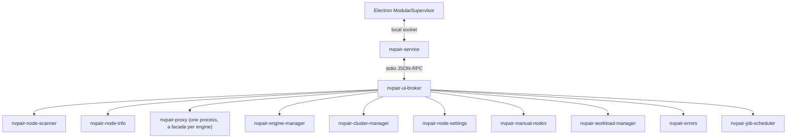

<!--
SPDX-FileCopyrightText: Copyright (c) 2026 NVIDIA CORPORATION & AFFILIATES. All rights reserved.
SPDX-License-Identifier: Apache-2.0
-->

# Services Backend Integration

The `services/` tree is Personal AI Router's backend and the source of truth for
service behavior. It lives as a sibling directory in this monorepo, and Personal
AI Router builds its bundled binaries directly from that source.

Personal AI Router does not reimplement backend behavior in TypeScript. Electron main owns
process startup, translates JSON-RPC into the stable frontend contract, and
projects backend notifications into renderer state.

## Runtime ownership

`nvpair-service` is the only backend process Electron ever starts, and only when
nothing answers on its endpoint. It owns `nvpair-ui-broker`, outlives Electron,
and lets Electron and the TUI attach over a local socket or named pipe. The
broker supervises every worker and relays its control plane.

| Binary                    | Runtime role                                              |
| ------------------------- | --------------------------------------------------------- |
| `nvpair-service`          | Per-user owner of the broker; multiplexes it for clients  |
| `nvpair-ui-broker`        | Worker supervision and relay                              |
| `nvpair-proxy`            | Engine routing proxy with cluster-mTLS ingress; one process hosting a facade per enabled engine |
| `nvpair-node-scanner`     | Discovery and node announcement                           |
| `nvpair-node-info`        | Node metadata and telemetry                               |
| `nvpair-manual-nodes`     | User-managed node entries                                 |
| `nvpair-workload-manager` | Workload replication                                      |
| `nvpair-errors`           | Error registry and peer sync                              |
| `nvpair-node-settings`    | Persisted node settings                                   |
| `nvpair-engine-manager`   | Engine lifecycle and model operations                     |
| `nvpair-cluster-manager`  | Pairing, trust, and membership                            |
| `nvpair-job-scheduler`    | Node-wide routing priority                                |
| `nvpair-tui`              | Bundled terminal client; attaches to `nvpair-service`     |

The runtime inventory and ownership flags live in
`src/shared/constants/modular-binaries.ts`. Product and component versions live
only in `services/versions.json` and are rendered into `docs/services-api.md` by
`service-contracts:write` — do not restate version numbers in this document.



Optional workers are non-fatal at runtime, but a normal build produces every
binary from the `services/` source.

## Electron integration

The main integration points are:

| Responsibility                                                     | File                                                 |
| ------------------------------------------------------------------ | ---------------------------------------------------- |
| Process startup, broker flags, subscriptions, notification routing | `src/electron/service-bridge/modular-supervisor.ts`  |
| JSON-RPC framing over the service socket, reconnect                | `src/electron/service-bridge/json-rpc-client.ts` |
| Service endpoint resolution, attach-or-start                       | `src/electron/service-bridge/service-endpoint.ts`, `service-connection.ts` |
| Pause toggle state                                                 | `src/electron/service-bridge/node-availability.ts`   |
| One-time manual node migration                                     | `src/electron/service-bridge/manual-nodes-migration.ts` |
| Logical invoke handlers                                            | `src/electron/service-bridge/empty-handlers.ts`      |
| Node, engine, workload, and error projection                       | `src/electron/service-bridge/modular-state.ts`       |
| Node telemetry polling                                             | `src/electron/service-bridge/node-info-poller.ts`    |
| Runtime binary inventory                                           | `src/shared/constants/modular-binaries.ts`           |
| Backend-coupled defaults                                           | `src/shared/constants/modular-runtime.ts`            |
| Frontend channel contract                                          | `src/shared/types/ws-channels.ts`                    |

After the broker emits `app:ready`, Electron subscribes to discovery, proxy,
engine, workload, cluster, and error relays. The bridge then emits renderer push
events from backend notifications.

Connector readiness follows the broker contract: `app:ready` establishes the
service connection, while per-engine proxy readiness remains an
asynchronous capability signal. Personal AI Router waits up to the canonical
startup deadline in `src/shared/constants/modular-runtime.ts` for
`app:ready`; an outright failure or stalled broker startup is surfaced in
Settings > Service with retry and log access. If a stalled broker reports ready
later, the connector transitions to connected without starting a second service.

### Node telemetry

Electron schedules a refresh for each healthy node every two seconds and merges
CPU, memory, GPU, and VRAM data into `metrics:update`; consecutive failures back
off to a 30-second cap and reset on success. A paired remote refresh calls
`discovery:get-node-info {hostUuid}` through the local service and broker. The
scanner resolves current admission, directory identity, and the pinned
direct/reverse route, then returns a fresh full sample rather than its cached
enrichment or compact scheduling telemetry. Self and unpaired discovery targets
retain direct `/v1/node-info` polling. A failed paired getter does not fall back
to unpaired direct HTTP or change membership.

Those renderer snapshots are display-only. Independently, the backend scanner
samples a compact maximum-GPU utilization value on the same healthy cadence,
with the same capped failure backoff, and sends it through the broker to the
scheduler.

All other service control flows through broker JSON-RPC. Engine proxy HTTP is
reserved for inference clients.

## Current domain routing

| Backend notification                                 | Personal AI Router handling                                                                                                     | Renderer push                                             |
| ---------------------------------------------------- | ------------------------------------------------------------------------------------------------------------------------------- | --------------------------------------------------------- |
| `app:ready`                                          | Complete broker startup and refresh snapshots                                                                                   | `state:request-refresh`                                   |
| `discovery:nodes-changed`                            | Replace discovery snapshot and diff nodes                                                                                       | `discovery:nodes-changed`, `nodes:upsert`, `nodes:remove` |
| `ollama-proxy:ready` / `lmstudio-proxy:ready` / `llamacpp-proxy:ready` | Record engine proxy port                                                                                          | `engines:state-changed`                                   |
| proxy `node/*`                                       | Update per-engine node presence; the advertised port is the peer's promoted proxy port (not the engine's private loopback port) | node and engine pushes                                    |
| `engine:ready` / `engine:state-changed`              | Update engine facts and models                                                                                                  | `engines:state-changed`                                   |
| `engine:settings-changed`                            | Validate and republish the owning node's settings snapshot                                                                      | `engines:settings-changed`                                |
| `engine:install-progress` / `engine:remote-progress` | Update operation progress                                                                                                       | engine progress pushes                                    |
| `errors:update`                                      | Replace the error snapshot                                                                                                      | `errors:update`                                           |
| `cluster:invite-received`                            | Parse inbound invite                                                                                                            | `cluster:invite-received`                                 |
| `cluster:invite-canceled` / `cluster:invite-expired` | Prune the canceled or timed-out inbound invite from the authoritative set                                                       | `cluster:pending-invites-changed`                         |
| `cluster:identity-changed`                           | Persist local identity                                                                                                          | `connection:cluster-identity`                             |
| `cluster:join-requests-changed` | Strictly parse the complete manager-owned eligibility/request snapshot | `cluster:join-requests-changed` |
| `nodes:changed`                                      | Replace membership snapshot                                                                                                     | `nodes:changed`                                           |
| `workloads:upsert` / `workloads:remove`              | Update workload catalog                                                                                                         | workload pushes                                           |

`nvpair-job-scheduler` combines queued and running work across all engines with
a smoothed 0–3 pressure from the busiest GPU. Invalid, missing, or
older-than-10-second telemetry receives neutral pressure. It emits
`schedule:priority` with order, pending count, and pressure; the broker applies
each snapshot to the matching proxy through `node/set-priority`
(generation-ordered so a stale async call cannot overwrite a newer snapshot,
and re-pushed when a proxy respawns). Each proxy atomically minimizes
`pending + gpuPressure + localReservations`, so simultaneous requests account
for one another before workload feedback arrives. None of this internal
scheduling traffic is forwarded to Personal AI Router.

## Engine lifecycle behavior

`nvpair-engine-manager` owns installed/running state, persisted engine ports,
model operations, and desired engine state across app restarts.

The backend emits terminal lifecycle state and install progress. Personal AI Router maintains
one centralized pending-action layer so controls respond immediately while
waiting for authoritative state. Pending state clears on matching engine state,
progress, or error pushes.

Local engine operations include install, start, stop, uninstall, update, port
changes, and model actions. Remote cluster operations use the engine manager's
remote control surface where supported.

### Engine settings

The bridge subscribes to engine events before reading local `engine:intent`.
The read and `engine:intent-changed` push carry required `enabledByEngine`
and `offByEngine` maps. Origins are `local` or `peer`, relative to the owning
device, and appear only for explicitly saved Off engines (legacy saved Off
without provenance reports `local`). Default false and On have no origin.
Strict parsing rejects missing maps, invalid values and origins for enabled or
unreported engines. The nullable bridge snapshot is exposed through
`engines:get-intent` and `engines:intent-changed`. Failed reads, malformed pushes
and service/broker/manager restarts invalidate it to null. Local read generations
and broker session fences prevent late reads from replacing newer state.

The typed engine API also exposes `switchEngine` and `switchStatus`, mapped to
`engine:switch` and `engine:switch-status`. The broker owns sequencing, drain,
intent and recovery; the bridge validates the complete receipt and republishes
`engine:switch-changed` as `engines:switch-changed` with node, request and sequence.
Status accepts `afterSequence` for a bounded wait. Numeric refusal codes survive
the IPC envelope, including configuration conflict (-32010), local veto
(-32011) and engine lock (-32013). The receipt parser accepts kind
`engine_locked` only with `-32013`.

Engine status carries an optional `locked` from engine-manager's `EngineStatus`
through local and remote facts; an absent value stays absent. The local-only
`engine:set-lock` is reached from `engine:command {command:'setLock'}` only for
this device's own node. The node projection the broker sends engine-manager
carries `managementBlocked`; the desktop does not read it. Model configuration
reasons include `paused` and `engine-locked`, and the older `paused-local` and
`engine-off-local` remain readable. An older desktop rejects a snapshot carrying
a new reason rather than showing generic text, so deploy the broker and its
clients together for complete policy presentation.

Ports and the engine arguments are one authoritative, revisioned record owned by
the node running the engine. The broker exposes `engine:{get,preview,apply}-settings`
and relays a request naming another node to that peer's engine manager, so a
clustered device is edited like the local one. Preview validates without
persisting or starting anything; apply journals the accepted revision, then
stops, rebinds the proxy, and restarts as needed, and returns only an
acknowledgement — the outcome arrives as an `engine:settings-changed`
notification, which Personal AI Router republishes as `engines:settings-changed`.
A revision mismatch is rejected rather than merged, and an operation interrupted
by a crash is recovered from the journal at the next startup.

`engine:configure-launch` is refused at the broker's client surface with
`-32601`: reaching the engine manager directly would skip the journal, the port
reservation, and the proxy rebind that apply owns. `engine:set-port` is the
port-only entry point the TUI uses; the broker intercepts it and runs the same
authoritative operation rather than forwarding it, so both callers validate,
restart, and persist identically.

Launch arguments and environment values pass through literally without an
engine-option catalog. Only managed networking and CORS are semantically
validated. Managed CORS origin-list and boolean-control changes must originate on the owning node; other
environment assignments can also be changed by a pinned peer.

`engine:stop` (and its cluster `ec` equivalent) reclaims an orphan a prior run
left on the engine's own managed port, terminating it only when that PID is
running the binary NVPAIR manages. A genuinely foreign listener on a different
port is declined with an actionable error, but the user's OFF intent is still
persisted. Personal AI Router therefore treats the saved desired state as authoritative and
surfaces a stop error as guidance, not as proof the OFF choice was lost.

Stopping a managed engine is bounded. On Unix, engine-manager sends SIGTERM to
the owned process group, waits the manifest's `stop.grace_s` (five seconds by
default), then escalates to SIGKILL; `signal:"kill"` skips the grace. Failed
startup cleanup and orphan reclaim use the same stop policy. On Windows,
windowless managed engines cannot receive a graceful (non-`/F`) close, so
stopping uses immediate `taskkill /T /F`.

Shutdown ordering belongs to the broker. Personal AI Router sends the broker `shutdown` and
does not stop the engines itself. The broker stops the proxy first, so no new
inference arrives, then calls `engine:prepare-shutdown`, which stops local
engine processes without clearing their persisted desired state, then waits for
each worker to exit without force-killing it, so engines are not orphaned. The
broker restores enabled engines on the next startup.

## Discovery and models

`nvpair-node-scanner` is the discovery authority. Broker
`AvailableNode` snapshots provide the stable per-host UUID (`hostUuid`), canonical
addresses, the `trusted` and `clustered` flags, model inventory, and per-engine
model attribution.

Personal AI Router keys every node by that `hostUuid`, the same identity the backend stamps on
workloads (`originatedFrom`/`scheduledOn`), errors (`nodeId`), proxy routing
(`Node.ID`), `/v1/node-info`, and cluster membership (`ClusterNode.nodeUuid`); the
hostname is kept only as the display `name`. This lets a single broker+proxy merge
resolve to one node and lets workload/error attribution land on the right node.

Local model state comes from `nvpair-engine-manager`; remote model state comes
from scanner enrichment of each peer's engine-manager `/v1/models` endpoint.

Model copy control uses `engine:copy-model`, `engine:cancel-model-copy`,
`engine:active-model-copies` and `engine:model-copy-capabilities` through the
existing broker relay. Copy start uses the existing JSON-RPC unlimited-wait
option and preserves the real terminal result. `engine:remote-progress` copy
frames carry the full tuple and operation ID; source-only attribution is
refused. Reconnect reads Go's active snapshot instead of reconstructing success.
After a verified copy, the bridge refreshes the actual destination status and
inventory: local destinations use engine-manager reads; remote destinations
adopt only their entry from the scanner's current discovery snapshot and keep
converging through scanner pushes. This snapshot read does not force immediate
peer enrichment. The controller's model store is never opened. Custom receipts
remain separate from native inventories, including setup and uncertain
durability qualifications. The typed API is documented in
[frontend-api.md](frontend-api.md#pairapiengines).

### When the backend drops a node

A node leaves the directory only after it has been absent from every mDNS scan
for the browser's full miss threshold — twelve scans at five seconds, so a full
minute — with a failed liveness probe on every one of those scans from the
fifteen-second mark onward. The window is sized to outlast a node saturated by
its own inference load, because such a node starves its own control plane: it
stops answering mDNS and stops accepting probe connections for as long as the
load runs, while still serving requests normally.

Waiting a minute does not mean looking once at the end of it. The scan cadence,
the two-second node-info telemetry sweep, and the per-scan liveness probe all
keep running, and any single success resets the counter and recovers the node
outright — so eviction rests on a run of about ten consecutive failures rather
than on whichever dial happens to land on the deadline.

A scan that returns *none* of several known nodes is treated as a local receive
failure rather than a mass departure, and penalizes nobody, for up to six
consecutive scans. Independent machines do not leave in the same five-second
window; a starved process hears silence from all of them at once. This needs two
or more known nodes to engage — losing a lone peer is ambiguous either way.

Two independent signals can vouch for a node inside that window and cancel the
eviction:

- a successful node-info enrichment in the last ten seconds;
- inference response bytes from that node in the last minute. Both proxies raise
  `node/activity` when a peer's engine streams a response back through them; the
  broker relays it to the scanner as `discovery:node-activity`. This is the only
  liveness signal that gets stronger as a node gets busier, which is exactly when
  the probe-based signals fail.

Eviction is a strong claim, not a guess: it is what fails the in-flight workloads
pinned to that node (`node <name> went offline`). Personal AI Router consumes the
result through the discovery snapshot and must not add a second, shorter
reachability verdict of its own — a failed `/v1/node-info` poll keeps the last
good metrics and never marks a node offline.

The model catalogue is backend-owned. `nvpair-engine-manager` serves the curated
Ollama, LM Studio, and llama.cpp lists over `engine:catalog`, filtered for the
operating system and CPU a model will install on; Electron relays the call and
maps rows for the renderer, which then sends pull-ready model IDs back through
the engine manager. llama.cpp's source is also searchable: the relay passes the
model hub's query through, and the engine manager searches Hugging Face with it.
The Ollama reply is a single multi-megabyte frame, so every hop on its path
shares `jsonrpc.WorkerFrameBytes`.

## Pairing and security

`nvpair-cluster-manager` owns node identity, PIN pairing, trusted certificates,
membership, and removal. Personal AI Router implements no cluster cryptography or transport
security.

Personal AI Router:

- starts and responds to pairing sessions;
- displays the inviter's six-digit PIN;
- cancels an in-flight outbound invite through `cluster:cancel-invite` (the
  backend invalidates the PIN and best-effort notifies the joiner, which reflects
  it via the consumed `cluster:invite-canceled` push);
- dismisses the receiver's PIN prompt when an unanswered invite times out — the
  backend expires inbound invites and pushes `cluster:invite-expired`, which
  Personal AI Router consumes to prune the pending invite;
- surfaces a `rejected` invite reason (notably `already-clustered`) and disables
  inviting a discovered node the broker reports as already `clustered`;
- persists identity changes through `nvpair-node-settings`;
- renders membership from `nodes:changed`.

Cluster membership correlates by `ClusterNode.nodeUuid` — the stable per-host
UUID that also keys discovery, workloads, errors, and `selfId` — never the
hostname (`ClusterNode.id`, which is display only). `nodes:remove` is sent the
UUID (self-removal routes to `cluster:leave`); a manual node's `node/remove` is
resolved back to the hostname the entry was keyed by.

### Ask-to-join admission contract

The service owns the request prelude as well as pairing. The unchanged broker
`cluster:*` relay exposes `cluster:get-join-requests`, `cluster:ask-to-join`,
`cluster:respond-to-join-request` and `cluster:cancel-join-request`.
The getter and `cluster:join-requests-changed` push carry the same full
`{supported:true, canAskToJoin, requiresSoloReplacement, blockedReason, requests}`
snapshot, fetched independently of `ClusterInitialSnapshot` on attach/reconnect.
The strict bridge parser, invoke registration and supervisor notification
demux/allowlist project this contract; Electron does not reconstruct request
eligibility or replace the manager's deadlines.

The selected member remains inviter/EAP Server, approves locally with its
own `allowRemoteManagement` choice and displays the pending child PIN via local
`cluster:invite-status`. The requester remains joiner/EAP Peer and supplies the
PIN and its independent grant choice through `cluster:respond-to-invite`.
Request IDs, exact child invite IDs and ordinary invites stay distinct.
Approval, discovery identity and unauthenticated HTTP status grant no trust.
Optional transcript-authenticated `PairingInfo.joinRequestId` binds the handoff;
only the exact confirmed durable pairing outcome permits `paired`.

The plain side of the existing cluster listener accepts strict version-1
`POST /v1/cluster/join-requests` operations `request`, `status`, `ready`, `cancel`.
This adds no listener/firewall permission. The manager enforces observed-source
binding, private IPv4/ULA/Tailscale CGNAT policy (fixture loopback allowed),
strict 4 KiB bodies, one outgoing/eight incoming requests, one incoming per IP,
bounded create/follow-up rates, source/terminal tables and eight nonblocking
HTTP handler slots. Callback uses only observed IP and validated port, never a
supplied callback URL or redirects. Request snapshots/status contain no PIN,
grant, roster, certificate or key; names/UUIDs remain unverified display claims.

Go checks authoritative durable composition before mutation. Explicitly
consented empty-solo replacement waits for member approval and a fresh safe
check, then durable teardown before `ready`. Retained/offline peer relationships
and unreadable or incomplete durable state refuse without clearing anything.
After replacement failure leaves the requester unclustered, retaining models,
engine/settings and node identity; retired admissions are never restored.
No TypeScript membership mutation or network approval is permitted.

Request lifetime is five minutes from local creation (`effectiveInviteTTL()`);
the child keeps its own TTL and canonical receipt/rollback semantics. Client
detach preserves work, manager restart invalidates memory-only requests.
Re-read membership after lost status. Old local `-32601` means unsupported;
initial peer HTTP 404 maps to `unsupported-peer`, later status 404 means lost
attempt. No fallback Invite or pre-approval solo teardown. Generic broker errors
preserve code/message but omit error data; read stable eligibility reasons from
the getter. Full RPC/HTTP shapes, exact bounds and cancel races are specified in
[cluster-manager spec §7.0.1](../../services/nvpair-cluster-manager/spec.md#701-ask-to-join-admission-requests).

### Secure inference (backend-owned)

An NVPAIR-launched engine binds to loopback only and is never directly
LAN-reachable. Each node fronts all of its engines with one `nvpair-proxy`
process, and every facade's LAN ingress is gated by cluster mTLS: only a pinned
cluster member can send it work. Discovery advertises the promoted **proxy**
port (never the engine port), and the broker hands the private loopback engine to
the local proxy via `node/set-local-backend`. Every cluster-scoped worker derives
its own membership from the cluster directory continuously, so a proxy's mTLS
ingress tracks a create, join, or leave with no worker restart. Loopback
plaintext requests from local clients are unaffected. This is entirely
backend-owned; Personal AI Router only reflects the advertised proxy port and does not
implement any of the transport security.

For an admitted peer, the backend prefers the advertised direct facade and can
reach that same ordinary mTLS ingress through its existing authenticated reverse
session after a bounded pre-dispatch failure. Inner mTLS, receiver admission,
and the prohibition on onward routing remain in force on either path.

## Building binaries

```bash
npm run build:modular-binaries
```

`scripts/build-modular-binaries.ts`:

1. validates the backend source and Go toolchain;
2. clears stale `cli-bin/` content;
3. cross-compiles every shipped component for the selected target;
4. stamps component versions from `versions.json`;
5. writes `cli-bin/manifest.json` with source fingerprint, target, versions, and hashes.

The build is cache-aware. CI passes `--force`. Packaging validates that
`cli-bin/` contains only the expected binaries and manifest.

## Contract artifacts

- `docs/service-contract-exceptions.json` records intentional ignored methods.
- `docs/services-api.md` is generated from `services/` Go source and records the
  current JSON-RPC method surface.
- `docs/services-parity.md` records current domain capability status without
  release history.

## Updating the backend

1. Change the backend source deliberately. The backend is the sibling
   `services/` tree in this monorepo. After edits, report drift from
   `desktop/`:

    ```bash
    npm run service-contracts
    ```

2. Review component version changes, emitted notifications, handled requests,
   and new binary components, then regenerate `docs/services-api.md` with
   `service-contracts:write`. Declare bumps for the affected components in the
   pull request's `pair-release-intent:v1` block as `services/VERSIONING.md`
   describes; `services/versions.json` is written by automation and CI rejects
   a hand edit. Do not
   hardcode product or component versions in this document or
   `docs/services-parity.md` — `service-contracts:check` fails if they appear.
3. Read the changed backend `README.md` / `spec.md` and the Go implementation.
4. Update Personal AI Router's runtime inventory, broker flags, handlers, state projection,
   frontend contracts, and current documentation as required.
5. Resolve every missing notification with a real consumer or a documented
   `ignoredMethods` reason in `service-contract-exceptions.json`.
6. Regenerate the API doc when RPC surfaces changed:

    ```bash
    npm run service-contracts:write
    ```

7. Verify:

    ```bash
    npm run service-contracts:check
    npm run build:modular-binaries -- --force
    npm run typecheck
    ```

8. Commit the `services/` change, the generated backend API surface, parity
   status, and integration changes together.

## Integration rules

- Edit the backend under `services/`; do not add a backend checkout inside
  `desktop/`.
- Do not run a worker from Electron and the broker simultaneously.
- Do not duplicate backend behavior in the renderer.
- Do not add alternate compatibility paths for old backend layouts.
- Treat `ws-channels.ts` as the renderer contract and backend JSON-RPC as an
  implementation detail of Electron main.
- Verify notification payload fields, not only method names.
