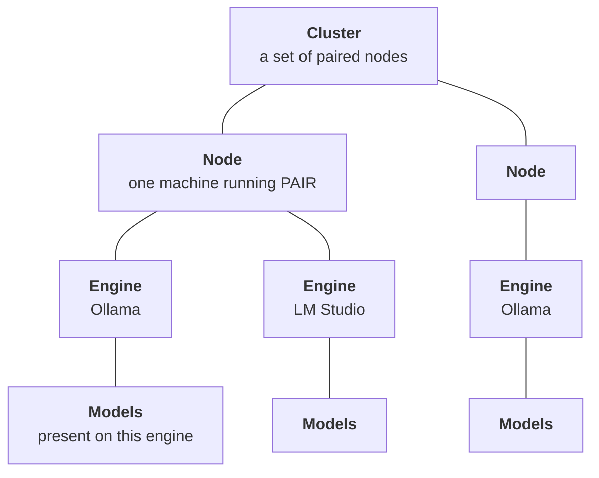
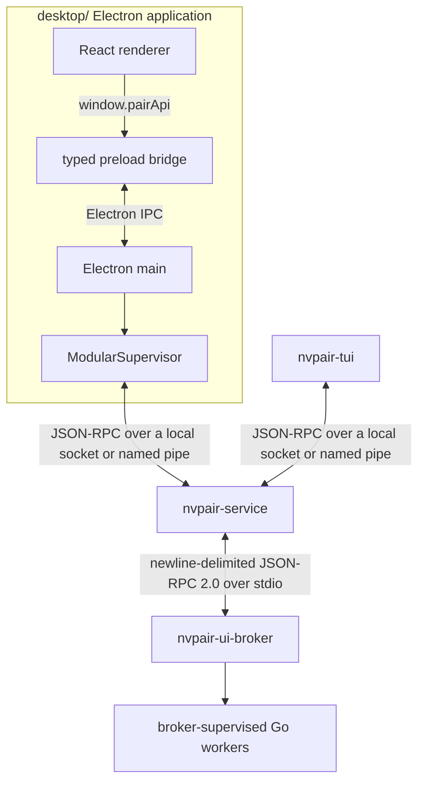
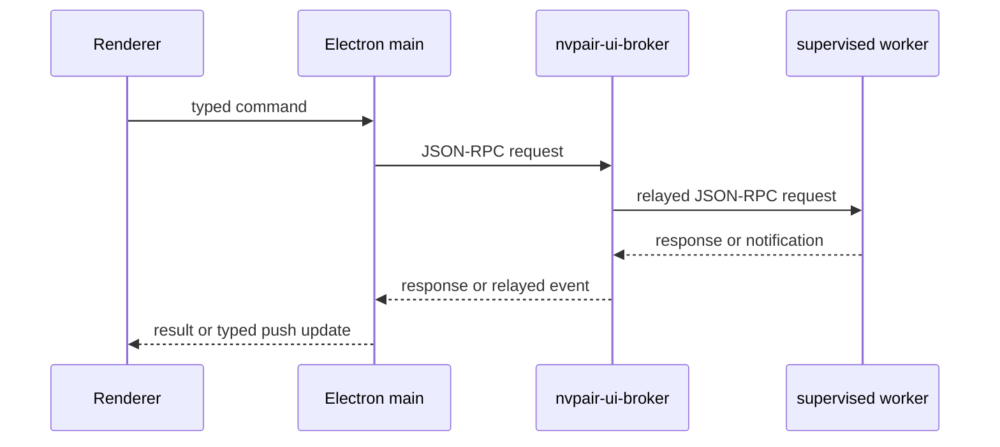
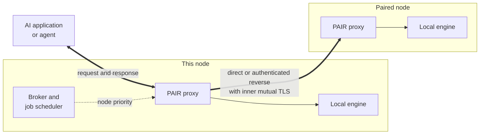
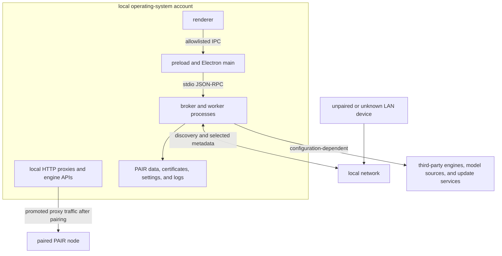

{/*
SPDX-FileCopyrightText: Copyright (c) 2026 NVIDIA CORPORATION & AFFILIATES. All rights reserved.
SPDX-License-Identifier: Apache-2.0
*/}

# NVIDIA Personal AI Router Architecture

Model configuration keeps generation/routing intent in broker node policy and
typed native load preferences plus accepted finite resolutions in manager engine
settings. `shared/modelconfig` is a portable wire/validation owner, not a native
argument parser or another settings database. Inspection travels through the
existing broker settings read relay and pinned engine-control listener; derived
facts and advisory estimates never establish readiness or qualification.
The broker's build-maintenance reservation and model-settings entry leases
exclude conflicting operations at their owners.

Staged build preview is local and read-only. Production build apply currently
refuses before Pause because the broker's `buildApplyOwners` is nil; accepted
transaction, helper, swap, restart, recovery and semantic-readback cases are
unmet pending owner decision O1. The transaction implementation is a finite
one-shot copy of `nvpair-service`, not a runtime worker or supervisor. Its
intended ordered stop, swap, restart and readback leave the node paused, retain
uncertain outcomes and require explicit local Resume; no automatic rollback is
promised. A pending or unknown operation gates ordinary startup. These paths do
not establish end-to-end or native acceptance.

Future downloaded signed packages need a resolver that supplies authenticated
immutable bytes and expected identity to this same transaction, without another
lifecycle owner. No download, signature verification or distribution guarantee
is provided by staged preview. Downloaded installation currently refuses before
stopping the connector.

Personal AI Router (PAIR) is a desktop-or-headless control plane around local Go
services and HTTP inference proxies. Its control traffic and inference traffic
follow separate paths.

## Cluster Shape

A cluster has four levels and a different component owns each one:

- A **cluster** is a set of nodes that have paired with each other. There is no
  founder, no primary, and membership is symmetric. A node belongs to at most
  one cluster.
- A **node** is one machine. Nodes are peers where each runs the same services, and
  each can both serve requests and route them elsewhere.
- An **engine** is an inference server on a node: Ollama, LM Studio, or
  llama.cpp. A node can run any combination. Serving requires a running engine;
  an explicit model binding can let a request wait for guarded activation.
- **Models** belong to an engine on a specific node. Nothing is shared. The same
  model on two nodes is two independent copies and that duplication is what makes
  the two nodes interchangeable for a request.

PAIR evaluates eligibility at the bottom of that hierarchy. A request names a
model, and dispatch requires fresh evidence that the destination's running engine
holds it. [Model engine bindings](model-engine-bindings.mdx) can additionally
offer a stopped engine for bounded preparation before ordinary admission. Cluster
membership admits a node to pinned peer routes; a working direct connection or
authenticated reverse session still determines reachability. Membership alone
does not make a node reachable or capable.

## Process Architecture

In this fork, `nvpair-service` is a per-user background process that owns
`nvpair-ui-broker`. Electron and the terminal interface are clients: each
connects to the service's local socket (a named pipe on Windows), starts the
service detached if it is not running, and detaches on quit, so inference keeps
running with no GUI open. In normal operation the broker starts
the scanner and available optional workers, monitors them, reports crashes, and
attempts bounded restart with backoff. Workers log to stderr, and stdout is
reserved for newline-delimited JSON-RPC when stdio is used.

The terminal interface is a client of the same service for headless use, and is
what the `nvpair` command on PATH resolves to. It and the desktop application can
be open at the same time, because both attach to the one service and broker.

### Health and Failure Detection

There is no `/health` endpoint on any PAIR service, and the broker does not
heartbeat its workers. What exists is uneven, so it is worth being precise about
the layers that are checked:

| Layer | How it is checked |
| --- | --- |
| Engines | A readiness probe on start, then a periodic health probe. Status carries a `healthy` flag, and a failed probe raises a service error. |
| Workers | Process liveness only. An exit is detected and restarted. A hang is not detected. |
| The broker | A `ping` request clients can call, which the terminal interface's health view uses. |
| Peer nodes | Reachability, not health: missed announcements, then recent inference activity, recent telemetry, or a probe of the node-info or engine-manager port before eviction. The inference proxies report activity but are never probed. |

Worker supervision is restart-based. An unexpected exit is retried with
exponential backoff from roughly one second to 16, with a budget of five attempts
for each unhealthy streak and a 60-second window after which a worker that
stayed up is considered recovered and its budget resets. A crash raises a sticky
error entry so the interface can show that a component is down. Recovery clears
it, and a worker that exhausts its budget is left down with the entry standing.
`nvpair-errors` is the exception that cannot report its own death, so its crashes
go to stderr instead.

The gap this leaves is a worker that is running but wedged. It is still holding its
stdio pipe, but no longer answering. Nothing detects that today. It is detected when
requests or by a UI state that quietly stops updating. To recover, restart the service from
**Settings > Service**.

## Control Flow

PAIR uses commands down and events up:

The renderer calls `window.pairApi` and preload carries those calls through
Electron inter-process communication (IPC). Electron main translates the stable
renderer contract to the broker's JSON-RPC methods. Backend notifications update
main-process state and produce typed renderer push events.

This entire path is local. The broker relays to workers on the same machine over
stdio and it is not a cluster transport. Facts about other nodes arrive through
the peer services described next, then surface as notifications on this path.

## Node-to-Node Communication

Nodes do not talk to each other over the JSON-RPC control path. Each node runs the
same set of HTTP services. Requests to an admitted peer service prefer its
advertised direct endpoint and can carry the same HTTP exchange over an existing
authenticated reverse session after a bounded pre-dispatch failure. The shared
peer/service adapter resolves the current admitted UUID, service endpoint, and
generation for each attempt. There is no central broker for the cluster. Every
node is both a client and a server.

### Transport and Authentication

Most peer traffic runs over *mutual Transport Layer Security (TLS)*. Each node
holds a stable universally unique identifier (UUID) and a self-signed leaf
certificate, and pairing pins each side's certificate against the other's UUID. A
cluster-gated endpoint verifies that its caller presents a certificate pinned for
a current member and refuses anything else, so a machine that can reach the port
but has not been paired cannot read model inventory, read workloads, or drive a
remote engine.

Certificates and pinning are owned by `nvpair-cluster-manager`. Refer to
[SECURITY.md](../SECURITY.md) for the trust model and its limits.

Not every surface is gated, and the exceptions are deliberate:

| Surface | Transport |
| --- | --- |
| Proxy, local clients | Plaintext HTTP, loopback only |
| Proxy, cluster ingress | Mutual TLS |
| Model inventory, remote engine control | Mutual TLS |
| Workload replication, error synchronization | Mutual TLS |
| Cluster membership | Mutual TLS, after pairing |
| Pairing itself | Plaintext, authenticated by the PIN |
| Ask-to-join prelude | Unauthenticated plaintext, source-bound and rate/capacity limited |
| Host and GPU telemetry | Plaintext HTTP directly; paired reverse reads carry plaintext HTTP inside the authenticated pinned session |

Pairing is plaintext because no trust exists yet at that point. The six-digit PIN
is what authenticates the exchange that establishes the pinned certificates.

### Requesting Admission Before Pairing

A standalone requester can ask one selected existing member to admit it.
Cluster-manager owns this bounded prelude. The member approves through its
existing per-user local service endpoint, stays EAP Server/inviter and displays
the ordinary PIN. The requester stays EAP Peer/joiner, enters that PIN through
ordinary invite acceptance and chooses its own remote-management permission.
Approval controls authority over the admitting device only; it grants no
membership or authority over the requester.

The local `cluster:get-join-requests` getter and
`cluster:join-requests-changed` push carry the same full eligibility/request
snapshot. `cluster:ask-to-join`, `cluster:respond-to-join-request` and
`cluster:cancel-join-request` use the existing generic broker/service relays.
The snapshot is independent of desktop `ClusterInitialSnapshot` and is fetched
on attach/reconnect, so a running service can retain a reviewable request with
no GUI attached. Incoming requests are passive review data, without automatic
modal/focus changes. Names/UUIDs are unverified claims before pairing; request
snapshots never carry PINs, certificates, keys or grants.

`POST /v1/cluster/join-requests` uses the existing cluster listener's plain
side, with strict version-1 `request`, `status`, `ready`, `cancel` operations.
Follow-ups require the observed source IP and exact random request ID. Ignore
forwarded-address headers and callback only to the observed IP and validated
pairing port, without redirects or caller-supplied callback URLs. Allowed
sources are private unicast IPv4, IPv6 ULA and Tailscale CGNAT; isolated fixtures
may use loopback. Public, link-local, unspecified and multicast sources are
refused. Canonicalize IPv4-mapped IPv6 before source accounting. These controls
bound unsolicited traffic; they do not authenticate it or add a listener or
firewall permission.

The service limits bodies to 4 KiB, outgoing work to one request, live incoming
work to eight globally/one per source IP and concurrent HTTP handlers to eight.
Create rate is one per IP per 30 seconds (burst one), globally one per second
(burst four); follow-ups share five per second per IP (burst ten). Source
accounting is capped at 128 with five-minute idle expiry; terminal records last
five minutes, capped at 64 without evicting live cancellation fences. Duplicate
creates do not refresh deadlines or prompt again; source-bound cancel-before-
create tombstones prevent resurrection. Body/operation timeouts are bounded and
excess handlers are refused before body reads/allocation. Exact shapes, source
ranges and HTTP errors are in the [cluster-manager specification](../services/nvpair-cluster-manager/spec.md#701-ask-to-join-admission-requests).

Approval starts no EAP. After observing approval, the requester rechecks
authoritative eligibility and explicit empty-solo replacement consent. Retained
peer relationships, including offline peers, unreadable stores, competing
pairing and incomplete publication/receipt/rollback/teardown block replacement.
An intentional empty solo stays intact before approval. After consent and a
fresh safe check, existing durable teardown retires that admission before
`ready`, preserving node UUID/keypair, models and engine/settings. Failure
afterward leaves it unclustered; never resurrect a retired admission.

`ready` rechecks member approval and admission/composition generation, then
starts exactly one ordinary member-to-requester invite. Optional
transcript-authenticated `PairingInfo.joinRequestId` binds the live request and
exact child; compare authenticated member UUID to discovery's expected UUID
when supplied. Unrelated invites cannot satisfy it. Only that child's confirmed
durable pairing result means `paired`; HTTP status is advisory. Existing
wrong-PIN, confirmation, compensation, exact pins, grants and receipt recovery
remain authoritative. Cancel/expiry fences late handoff; durable completion
winning a late cancel is preserved, never unpaired. Requester inbound blocking
can still fail the member's callback; this adds no outbound-only transport.

Requests live for `effectiveInviteTTL()` from local creation (production five
minutes), without refresh; a child invite keeps its own TTL. Client detach
preserves work, manager restart loses memory-only requests. Lost status requires
checking actual membership on both devices before retrying. Old local
method-not-found means unsupported; initial peer HTTP 404 means
`unsupported-peer`, later status 404 means lost attempt. There is no fallback
Invite or early solo teardown. Ordinary compatible invites keep their contract;
cluster merging and automatic joining remain outside this flow.

### Node Telemetry

Node telemetry is a considered trade-off, not an oversight. Its direct endpoint
is the lowest-sensitivity inter-node surface and remains plaintext so unpaired
discovery consumers can read it. For a paired remote read, the scanner resolves
the current admitted peer and can carry that same plaintext HTTP request inside
the authenticated pinned reverse session; it validates the reported host and
cluster identities before returning the fresh sample. This does not authenticate
the direct endpoint itself. Hostname, hardware inventory, and utilization remain
readable by anything on the same subnet that can reach that endpoint. Do not run
PAIR on a network where that is unacceptable.

### Two Personalities on One Port

The proxies serve local inference and trusted ingress on a single port, chosen
by the connection's first byte. Cluster-manager uses the same split-listener
mechanism with its own plain pairing/admission-request routes described above.
A TLS handshake record starts with
`0x16`, and no HTTP method does:

| First Byte | Personality | Who Uses It |
| --- | --- | --- |
| Not `0x16` | Plaintext HTTP, loopback only | Your local applications |
| `0x16` | Mutual TLS | Paired nodes in the cluster |

This is why an endpoint is `http://127.0.0.1:11434` for an application on the
machine itself while the same port serves authenticated TLS to the network. Local
clients need no certificates, and routed inference between nodes is never
plaintext.

For the proxies, the loopback restriction is enforced. The listener binds
all interfaces so the TLS personality can accept peers, but a plaintext request
from any non-loopback address is refused with `403`. Without that check the port
would be an open relay for anything on the network.

Two consequences follow, and together they define how clients are expected to
reach PAIR:

- **A machine that is not a node has no way in.** It cannot use the plaintext
  personality, because it is not loopback, and it cannot use the TLS personality,
  because it holds no pinned cluster certificate. Pointing an application at
  another machine's proxy port does not work by design.
- **A peer request is served, not re-routed.** The mTLS ingress forwards straight
  to that node's own engine and never re-enters candidate selection, so a peer
  cannot chain a request onward through a third node.

The second point is why the routing decision belongs to the machine the request
originates on. To give a workstation the whole cluster, make it a node. After it is a node, its local
proxy then routes on its behalf, whether or not it runs an engine itself.

### What Peers Exchange

Beyond routed inference, the peer services replicate the state the interface
shows:

- Host and GPU telemetry
- Per-node model inventory, so the proxy can judge a node eligible for a request
- Workload events, so every node can show jobs running anywhere in the cluster
- Service errors, so a failure on one node is visible from another
- Cluster-scoped engine control, for operating a remote node's engine

Each of these listens on its own port. Refer to the [port map](#port-map) below.

Electron samples healthy nodes every two seconds; consecutive failures back off
to 4, 8, 16, then 30 seconds and reset on success. Paired remote reads call
`discovery:get-node-info {hostUuid}` through the local service and broker. The
scanner owns the fresh full read, admitted endpoint selection, identity checks,
and direct/reverse route. Self and unpaired discovery targets retain direct
`/v1/node-info` polling, which is Electron's only service-data HTTP exception.
A paired failure does not fall back to unpaired HTTP or change membership; the
client retains its existing unavailable and last-good presentation. Separately,
the backend scanner samples compact maximum-GPU utilization for scheduling with
the same healthy cadence and capped failure backoff, which the broker relays
straight to the job scheduler. Routing never depends on renderer metrics.

## Inference Data Flow

Inference HTTP does not travel through the renderer-to-broker JSON-RPC path.

Responses stream back along the same path they arrived on. One request goes to one
node and the proxy never splits it.

The shared peer/service adapter also carries model listing and file reads through
the admitted peer's `ec` service. It preserves status, headers, ordered body bytes,
backpressure, and cancellation without buffering a full inference response or
model file. Transport does not replay a dispatched request or resume an exposed
body. Model copy owns any later Range request and verifies the completed file's
hash before publication.

Engines started by PAIR bind to loopback, so a peer never reaches another node's
engine directly. It goes through that node's proxy, which is the only
cluster-facing entry point.

### How a Node Is Chosen

The proxy owns the per-request decision, and it does not produce a single winner.
It produces an **ordered failover list** of nodes eligible for that request, then
walks it.

For model-bearing inference, eligibility is a hard gate: the proxy takes a
request-local copy of the latest discovery snapshot and keeps only nodes whose
per-engine inventory advertises the requested model. Within that owner set, or
across all candidates when the request has no parsed model, the order is:

1. **A manually selected node**, if one is pinned.
2. **The scheduler's priority order**, which is the normal case.
3. **Remaining nodes by stable node ID**, so cold start and unlisted nodes are
   predictable rather than random.

Manual selection is a proxy capability that neither front end uses. The desktop
application and the terminal interface both render routing state and let the
scheduler decide, so automatic routing is the only case PAIR produces.

<Note>
A pin cannot override model eligibility. If the pinned node does not advertise
the requested model, automatic ordering continues among the advertised owners.
</Note>

This is why the broker and the scheduler appear in the diagram. Neither touches
the request, and their only job is to keep the proxy's preference order current.
`nvpair-job-scheduler` holds no socket and never talks to another node, so an
ordering reaches a proxy in three steps:

1. The broker feeds the scheduler every workload transition it accepts, locally
   or from a peer, plus compact GPU telemetry from discovery.
2. The scheduler ranks the nodes and hands the ordering back.
3. The broker relays that ordering to each proxy.

The ranking combines *pending work and GPU pressure*. A workload counts as
pending while it is queued or running, and it is attributed to the node it was
placed on. Every engine counts in the same node-wide pool, so work through one
facade affects the others' ordering.

GPU pressure is deliberately coarse. The scheduler smooths the busiest GPU's
utilization, maps it to 0–3 pressure units at 40%, 70%, and 85%, and uses lower
thresholds on the way down to avoid rank thrash. Missing, invalid, or
older-than-ten-second telemetry contributes a neutral pressure of 1. Nodes sort
by pending plus pressure, then by pressure, then by node ID, which makes cold
start deterministic. Rankings recompute when a meaningful input changes,
reconcile on a one-second timer, and are only published when the order, the
counts, or the pressure changed.

Ranking cannot close one gap on its own. A node's pending count only rises after
its workload report arrives, so requests dispatched at the same moment would all
see the same idle node and pile onto it. To prevent that, each proxy adds the
requests it has just dispatched itself to its own estimate and reserves its
choice before forwarding, so a burst spreads without waiting for those reports.

### Models Do Not Need to Be on Every Node

**You do not have to put the same models on every node.** A cluster where one
machine holds a large model and another holds a small one is a supported and
sensible configuration. The proxy matches each request to the nodes that can
serve it.

The important thing to understand is that the scheduler and the model matching are
two different mechanisms, and they compose in one direction:

- **The scheduler is model-blind.** It ranks every node by pending work and GPU
  pressure. It does not know which models exist where, and its ordering never
  mentions a model.
- **The proxy enforces model capability.** It requires matching inventory or a
  supported explicit binding offer. Within equivalent policy classes, ready
  owners precede preparation candidates before scheduler selection.

So load balancing happens **among the nodes that can serve the request**, not
across the cluster as a whole.

#### Capability Gate

When an inference request contains a non-empty model, candidates need matching
current engine inventory or a supported `engineBindingOffers` entry. Empty or
nonmatching inventory alone remains ineligible. Offers are separate from
inventory, engine health and strict readiness; a stopped offered facade can
remain reachable without making its engine healthy. Ollama's implicit `:latest`
tag is normalized; exact-name descriptors retain native ID matching.

Without an eligible owner or supported offer, the proxy retains its local
no-owner `502`. A selected offer can wait within one preparation budget, then
must pass fresh endpoint, native inventory, policy and ordinary admission checks
before dispatch. Known preparation refusal is a bounded `503`. Strict hybrid
dispatch excludes cold offers. The [binding guide](model-engine-bindings.mdx)
describes ready-first classes, explicit selection, bounds and refusal semantics.

A request whose model cannot be parsed keeps the ordinary non-model ordering.

Model listings are not routed at all. A `GET` of `/v1/models`, Ollama's
`/api/tags`, or llama.cpp's `/models` is fanned out to every candidate for that
engine concurrently and the replies are merged, which is why the answer is the
cluster's inventory for that engine rather than one node's. Binding offers do
not add invented models to those listings.

#### Failover and Inventory Freshness

An advertised owner's inventory can still become stale after candidate
selection. If that owner answers inference with `404`, the proxy treats it as
retryable and moves to another eligible inventory owner or supported preparation
candidate, inside the original request bounds. It never broadens to unknown
nodes. Genuine client errors such as `400` or `422` are
not retried, because they would fail identically everywhere.

#### Planning Model Placement

Where you put each model decides what routing can do with it:

- **One copy of a model means no balancing for it.** Every request naming it goes
  to the node advertising it, however loaded that node is, because no peer can
  be substituted.
- **Preparing a model on more nodes is what gives the scheduler room.** With the
  same model advertised on three nodes, the scheduler's GPU-aware load order
  decides among them. This is the reason to duplicate a model, and the only
  thing that makes those nodes interchangeable.
- **Mixed inventories work.** Node A can hold a 70B model and node B a 7B one.
  Requests for each are steered to the node that has it, and neither blocks the
  other.
- **A stopped engine is not ready capacity.** An explicit supported binding can
  offer bounded activation; it still needs fresh model and admission evidence
  before serving. Without a binding, existing unbound wake rules are unchanged.
- **Where work actually ran is observable.** Use the **Jobs** view rather than
  inferring routing from inventory.

### Scheduler Limitations

There is one policy today and it combines job count with coarse GPU utilization.
That is useful load feedback rather than a complete capacity model. These are the
known limitations, stated plainly so you can predict where routing falls short.

**It sees pressure, not capacity.** GPU model, available VRAM, and measured
latency are not inputs. The same utilization percentage maps to the same pressure
on a small and a large GPU, so a mixed cluster can still favor a slower machine.
Missing or stale telemetry is neutral rather than treated as idle.

**Multi-GPU nodes use the busiest device.** The compact telemetry feed reports
the maximum utilization across GPUs. That conservative choice avoids steering
more work to a node with one saturated device, but the scheduler does not know
which engine or model uses which GPU and can overlook idle capacity elsewhere on
the same node.

**Every workload counts as one.** A three-token completion and a long generation
are the same unit of pending work, so "fewest jobs" is not "least busy." A node
running one enormous request looks more idle than a node running two trivial ones.

**Loaded preference belongs to routing policy.** The scheduler remains
model-blind. Concrete-tier routing applies its existing `preferLoaded` policy,
and binding preparation is ordered within the resulting tier/warmth classes.
Ordinary inventory eligibility does not promise that the model is loaded or
that admission will succeed.

**Only work PAIR routed contributes to pending counts.** Inference sent straight
to an engine's own port is absent from workload events. GPU-heavy external work
can still raise pressure, but CPU-only work and queued demand remain invisible.

**All engines are counted as one pool.** Ollama, LM Studio, and llama.cpp load is
summed, and maximum GPU pressure applies node-wide. This is conservative on a
typical single-GPU machine and can underuse a multi-GPU node where the engines
occupy different devices.

**Every node ranks from its own view, and views lag.** There is no shared
schedule. Two nodes dispatching at the same moment can briefly steer work to the
same idle peer, because each sees an eventually consistent picture and a peer's
counts trail by relay latency. Per-proxy reservations cover the local burst case,
but they are local: one node cannot see what another just dispatched. The system
self-corrects through workload relay and periodic reconciliation rather than
preventing the collision.

**Unranked nodes fall back to identity order.** A node the scheduler has not
ranked yet is ordered by node ID, which has nothing to do with load. That happens
at cold start, or for a manual proxy target the scheduler's discovery never saw.
The fallback degrades ranking quality without causing a misroute. Missing
telemetry for a ranked node is different: that node takes the neutral pressure
value and stays in the normal ranking.

Improving this, and likely offering a choice of policies, is planned work. Which
of these gaps matters most depends on the hardware people actually run, so
reports from real deployments are more useful than guesses. Refer to
[Roadmap](../README.md#roadmap).

## Engines and Ports

`nvpair-engine-manager` owns everything about a local engine except serving
inference. It finds the engine, installs it, starts and stops it, and chooses the
port it listens on.

### Finding an Engine

PAIR does not assume it installed the engine. Detection checks the manifest's
known install locations for each engine, so an Ollama or LM Studio you installed
yourself is found where it already is. "Installing" an engine that is already
present downloads nothing and reports it as installed.

llama.cpp uses PAIR's managed router rather than an arbitrary existing server.
Its readiness check requires the listener to identify itself as a router, so a
single-model `llama-server` on the configured port is rejected instead of
adopted. Its models live in `~/.llamacpp`, outside PAIR's own data directory, so
they survive uninstalling the engine, resetting PAIR's data, and removing PAIR.

Starting is similarly deferential. If something is already serving the engine's
port, PAIR **adopts** that instance instead of spawning a second copy, and reports
it as running even though it did not start it.

Adoption is a real distinction, not a label. PAIR cannot stop or move a process
it did not start, so it refuses operations that need process ownership rather
than faking them. Changing the port of an adopted engine returns an error
instead of leaving two listeners on different ports. To get an instance PAIR can
fully manage, stop the engine in its own application and let PAIR start it on a
port nothing else is serving.

### Port Takeover

An application that already works with Ollama is configured for `11434`. If PAIR
listened somewhere else, every tool would need reconfiguring to gain anything, so
PAIR inverts it: the **proxy** takes the port the engine would normally use, and
the engine moves behind it — Ollama to `11435` and upwards, LM Studio to `1235`
and upwards. The managed llama.cpp router stays on `8081` while its facade takes
`8080`. Existing clients keep working untouched and transparently gain the cluster.

This is also what makes the engine unreachable from outside. Engines PAIR starts
bind to loopback, so the only network-facing listener is the proxy, which is where
cluster authentication lives.

An inherited `OLLAMA_HOST` naming a different local plaintext port is honored as
well. The broker gives the proxy that normalized loopback-only alias, reserved
against every engine and every facade's port plan so a relocating engine can never
land on it. `localhost` claims IPv4 and IPv6 together, and remote and HTTPS
targets are never intercepted. Clients already configured through the variable
therefore enter the same routing path without being reconfigured.

The rearrangement is conditional, and PAIR yields rather than fights:

- An **unknown process** is never moved or killed, whatever is holding the port.
- A running externally owned engine PAIR **adopted** is left alone. An official
  stop command, including LM Studio's `lms server stop`, does not confer ownership
  or permit automatic relocation. Reclaiming a managed-process orphan instead
  requires positive managed-install, image and endpoint evidence.
- If the engine is already running on the compatibility port, PAIR does not take
  that port. The proxy stays where it is and the takeover is reported as blocked.
- If anything else holds the port, the outcome is the same. PAIR steers the proxy
  to a free port and raises a warning rather than forcing a conflict.

The practical consequence is the one in
[Troubleshooting](troubleshooting.mdx#requests-work-but-pair-shows-no-jobs). Start
the Ollama desktop application and it takes `11434` for itself, so PAIR cannot,
and requests reach that local Ollama without ever being routed.

### Port Map

A default installation listens on these ports:

| Port | Listener |
| --- | --- |
| `11434` | Ollama-compatible proxy (Ollama itself moves to `11435`+) |
| `1234` | OpenAI-compatible proxy (LM Studio moves to `1235`+) |
| `8080` | OpenAI-compatible llama.cpp proxy (managed router on `8081`) |
| `14318` | Node hardware and model inventory |
| `14319` | Service-error synchronization between nodes |
| `14320` | Workload propagation between nodes |
| `14321` | Pairing and cluster membership |
| `14322` | Model list served to cluster peers |
| `14323` | Cluster-scoped remote engine control |

The `143xx` listeners are the peer surfaces from
[Node-to-Node Communication](#node-to-node-communication). Their numbers are
fixed, so the broker can tell a worker which port to serve without a handshake.

The components that own proxy and engine ports persist them and restore them on
the next start, so a port a user chose survives a restart. Refer to
[Ports](getting-started.mdx#7-connecting-your-agents-and-port-information) for how
to change one.

## Discovery and Identity

`nvpair-node-scanner` is the single place a host advertises itself and the single
place it learns about the LAN. Other services register their ports with it rather
than advertising separately, and consumers subscribe to its directory rather than
browsing themselves.

### One Record for Each Node

The scanner advertises one `_nvpair-node._tcp` multicast DNS (mDNS) record for
each host, and that record carries two kinds of content:

- The ports its sibling services registered: node-info, engine proxies, errors,
  workloads, cluster manager, and engine manager
- The node's identity: `uuid=`, `cluster-uuid=` after clustering, and where to
  reach it — `ip=` for the address the node ranks first, and `ips=` for the whole
  ranked list

Publishing the list rather than one address is what lets a peer keep trying. A
machine can be reachable on one interface and not another, so a peer works
through the candidates instead of giving up on the first, and remembers the one
that answered.

One consolidated record instead of one for each service is a deliberate
constraint. mDNS TXT records are small, so per-service records would not hold the
payload. Bulky facts like the model list are fetched over HTTP afterwards instead
of being crammed into TXT.

### Admitted Peers Without Inbound Multicast

Scanner also accepts a private authenticated service claim when an admitted peer
never appears in mDNS. Cluster-manager uses current membership to locate `cl`,
then reads the peer's own complete service descriptor over its existing pinned
direct/reverse client. The serving peer derives identity and ranked addresses
from its scanner self row, and ports from current broker registrations. A roster
entry or a reverse connection alone cannot create operational service presence.

The private descriptor also appends missing sorted IPv4 overlay hints in
`100.64.0.0/10` from locally enumerated virtual/overlay interfaces. Scanner
identity must already be valid; the canonical scanner address stays first.
The public four-address cap remains: at capacity the last scanner entry yields
to the first missing overlay, never the first entry. This does not add mDNS
publication, but existing `netpick.peerProven` publication is unchanged; an
overlay address may already qualify for publication there. Interface heuristics
are not proof of a configured or reachable native tailnet. Tailscale setup,
routing, ACLs and host firewall policy remain operational responsibilities.

Cluster-manager captures the exact local and remote admission/certificate
incarnation before the read and revalidates it after the complete bounded
response. Broker consumes its private event only from the current child and
relays a typed private notification to scanner, which checks the original
incarnation again at apply. These envelopes never reach ordinary clients and
cannot modify local reverse-forwarding targets. Protocol selection and inner
protected-service mutual TLS retain their existing owners.

After complete authenticated decoding, CM stores optional
`advertisedAddresses` locator hints on confirmed members. One membership-store
boundary serializes every snapshot through replacement; a hint transaction
holds composition then storage ownership, uses the memory lock only briefly,
and rolls back only hints on a pre-replacement failure. Landed writes keep the
existing adoption policy. Removal/teardown clears member hints. The broker's
membership relay preserves the optional field; desktop/TUI membership parsers
project their existing fields. The HTTP descriptor remains a separate strict
`noderec` contract, not an extension to those UI membership types.

After restart, the resolver combines the recorded member endpoint, Browser
endpoints with their own port, and bounded persisted hints with the member
port, preserving order and deduplicating endpoints without prefix truncation.
TCP chooser confirmation precedes authentication. A descriptor refresh keeps
an eight-second parent budget and divides remaining time across complete
remaining attempts, including TLS/setup, headers, body and EOF. Cancellation
interrupts the chooser wait without caching an abandoned result or negative
cooldown. Timeout-only probes already running may finish later and close their
connections; OS connects are not promised immediate cancellation.

Scanner atomically reconciles authenticated and mDNS claims. A current
authenticated snapshot takes precedence; service omission withdraws the old
service, and a multicast update or removal cannot overwrite or delete that
snapshot. Losing authenticated authority clears only that claim, retaining an
independent browse record when present. Normal discovery events update every
existing subscriber and all public reads use that same directory.

Refreshes serialize per peer, retry with bounded concurrency and time, and
reconstruct state after worker restart. Successful observations expire after
30 seconds without refresh; route failure cannot renew them or remove durable
membership. Leave, removal and same-certificate re-pair invalidate old work.
Descriptor metadata does not establish liveness, trust or membership, and cannot
select protocol, filesystem state or a tunnel's local target. Remote loopback,
unspecified, multicast and non-IP candidates are rejected, so the reverse
gateway's loopback/ephemeral endpoint never becomes a public address.

Saved hints supply locators only. Fresh private claims still pass through
`cluster:peer-services`, the current broker child and `discovery:peer-services`
before scanner directory consumers perform inventory, inference eligibility
and control checks. Hints alone cannot create fresh inventory or an eligible
model. Synthetic pinned-TLS/reopen tests establish the fallback path, not native
Tailscale or away-from-home acceptance.

Peer removal prepares its exact-admission proof in memory, selects one
current endpoint, and persists the proof only after rechecking that the
selection and admissions are still current. Selection and notification share the existing ten-second
budget; at most one authenticated POST uses the fresh removal adapter before
final de-pin. It does not redirect or replay a lost/partial reply. Original
admission/pin/endpoint rechecks and adapter first-write guards remain, without
promising atomic network send against every subsequent composition change.
Unavailable, timed-out or failed-authentication notification still permits the
existing best-effort local removal after a final admission check; durable proof
supports convergence and local success does not imply remote acknowledgement.

### Node Identity

PAIR identifies every node by a stable UUID, never by its hostname.

An mDNS instance name defaults to the hostname, so two machines that share one
would silently merge into a single node. Every service therefore advertises a
per-host UUID, and the directory is keyed by it.

That UUID is the correlation key across the entire system: discovery entries,
cluster membership, workload attribution, error reports, telemetry, and proxy
routing all resolve against it. Hostnames are display only. A machine can be
renamed without becoming a different node, and a duplicated hostname does not
collapse two machines into one.

The UUID reuses the cluster manager's persisted identity when that exists, so one
host presents the same UUID everywhere. If the cluster manager has never run, the
scanner mints one and persists it.

### Sharing UDP 5353

PAIR runs its own mDNS responder rather than depending on a system one, because
Windows ships none. Its receive socket and short-lived per-interface send
sockets bind UDP 5353, as RFC 6762 requires for mDNS queries and responses.
Binding each sender to the selected interface address also preserves reliable
egress on multi-homed Windows hosts.

Those sockets set `SO_REUSEADDR` so they coexist with Bonjour, Avahi, and other
PAIR processes. A Darwin sender also sets `SO_REUSEPORT`, matching the BSD
multicast sharing behavior needed to coexist with the system mDNS responder.
Linux deliberately omits `SO_REUSEPORT`: there it can load-balance incoming
unicast datagrams into a short-lived send socket and steal replies from the
long-lived receiver.

### Node Enrichment

Announcements establish that a node exists and which ports it serves. PAIR
fetches the interesting facts afterwards over HTTP. Admitted peers use the
shared direct/reverse service route; unpaired nodes use their direct endpoint:

- GPU, CPU, and memory inventory from its node-info port
- Its model list from its engine-manager port, as a flat union, a per-engine
  breakdown, and the per-engine set of models currently loaded in memory

Each enrichment keeps a last-good value, so one failed fetch dims nothing. A
node's card does not blank out because a single poll timed out.

With a cluster directory configured, a browsed peer whose `cluster-uuid=` matches
a pin this node holds is annotated as trusted, which is how the interface can
distinguish a paired node from a stranger it can merely see.

### Node Eviction

The scanner scans every five seconds and tolerates three consecutive misses
before it treats a node as gone. Even then it does not drop the node right away.
It runs these checks and keeps the node if any of them answers:

- Inference the node served in the last minute, which the proxies report
- Recent telemetry from that node
- A direct request to the node's node-info endpoint
- A probe of the engine-manager port

The activity check comes first because a node under load is the one most likely
to miss an announcement, and evicting it would pull a working machine out of the
routing pool at its busiest.

The remaining checks deliberately avoid the inference proxy ports. Those ports
exist to serve requests, and using them as a liveness test would put connection
attempts on the serving path every time multicast dropped a packet.

Multicast is lossy, and Wi-Fi, VPN adapters, and sleeping network interfaces all
produce gaps that have nothing to do with a node's health. Without that probe a
momentary gap would evict a perfectly healthy node and take its models out of the
routing pool.

Discovery holds record replacement to the same standard. A node can reappear with
a new identity, for example after a reset. The old entry then looks superseded,
and leaving both in place would list the machine twice. But a matching address
and hostname arrive in an unauthenticated announcement that anything on the
network can send, so those signals only mark the old record as a suspect.
Discovery confirms the node's identity before dropping that record. A stale
duplicate therefore cannot linger, and nothing can displace a peer by claiming
its address.

### Manual Nodes

Some networks block or filter multicast, so discovery is not the only path in.
`nvpair-manual-nodes` takes an address you enter directly and probes it on a
fixed interval, and a manual node that answers is folded into the same directory
as a discovered one. It is initially keyed by the address you typed, and re-keyed
to the peer's real UUID as soon as that node reports it.

## Trust Boundaries

The important boundaries are:

1. **Renderer to Electron main.** Preload exposes allowlisted APIs. Electron
   main owns native operations and subprocess lifecycle.
2. **Electron or terminal interface to broker.** Stdio has one parent peer.
   Optional socket or named-pipe mode relies on operating-system endpoint
   permissions. JSON-RPC has no independent per-message token.
3. **Loopback HTTP.** Local clients can submit sensitive inference content.
   Listener addresses, browser access, CORS, and host account security matter.
   The proxies add no permissive CORS default: they pass the upstream engine's
   headers and its refusals through, so a web page reaches a model through PAIR
   only where the engine would have allowed it directly, and a cluster-wide
   request needs every engine that answered to allow the origin. Refer to
   [Engine settings](engine-settings.mdx) for allowing an origin.
4. **LAN discovery and metadata.** The network can reveal service presence and
   selected host information. Some enrichment endpoints use plain HTTP.
5. **Pairing bootstrap.** A six-digit PIN bootstraps certificate trust. It is a
   convenience code, not a high-entropy long-term authenticator.
6. **Cluster boundary.** Cluster-scoped workers and promoted proxy ingress are
   designed to use pinned certificates and mutual TLS after pairing. This does
   not protect every local or discovery endpoint.
7. **Third-party boundary.** Engines, models, catalogs, and update mechanisms
   have their own network behavior and terms.

Refer to [SECURITY.md](../SECURITY.md) for deployment assumptions and reporting.

Pairing establishes trust; a separate target-local remote-management grant
authorizes changes. Each device's operator chooses whether the peer may manage
that device during invitation or acceptance, initially blocked, and can later
edit the choice locally in desktop Cluster Settings or TUI Nodes (`g`). Only
clients on the user's existing service endpoint can change grants, subject to
its OS access control; this is not proof of physical presence. A peer can read
only its own effective permission through pinned `GET /v1/remote-management`,
relayed by `engine:remote-management-get {nodeId}`. There is no peer setter.

Cluster-manager owns the grant document and a durable one-time migration marker
under `cluster/`. The first PG startup automatically grandfathers only matching
authorities from its original pin/admission snapshot. Future pins and gossip do
not grant management. Completed migration is never rerun after leave or missing
grant storage. Grants bind both admissions and certificates; re-pair or
readmission invalidates old authority. Missing, invalid, changing or incomplete
state denies, without a cached allow. See the
[cluster-manager contract](../services/nvpair-cluster-manager/README.md#remote-management-permission)
for local CAS RPCs and recovery limits.

Engine-manager's `ec` route registry gates all mutations with the shared
permission predicate; broker policy, availability, settings and switch owners
recheck immediately before acceptance. Denial is HTTP 409
`remote_management_denied`, preserved as RPC `-32012`; unpinned callers remain
403, target veto is `-32011`, engine lock is `-32013` and revision conflict is
`-32010`. Reads, status and permitted inference remain available. Grants cannot bypass pause, engine locks,
private policy, CORS, served-model or resident protections. Revocation blocks
new acceptance, including queued broker writes, while already accepted work
can finish or reconcile and remains visible in progress and receipt reads.
It does not stop or unpair the device.

### Per-model inference settings

Target policy profiles now carry `requestOptionsMode` and `localOnly`. Omitted
mode means client-overridable `defaults`; omitted local-only means false.
The serving proxy's `enforced` mode replaces each configured scalar/array leaf and
merges objects recursively, leaving other request fields client-controlled.
Configured-key ambiguity refuses with a fixed HTTP `400` before engine contact.
Qualification binds the effective mode as well as options. A paired route uses
only the serving node's profile, not the origin's profile for that peer.
The desktop's `Allow request overrides`, `Force PAIR values` and profile-level
`Only this device can edit` controls share the existing policy JSON draft and
revision-checked Save. Remote lock state comes from the saved target snapshot;
raw draft edits cannot unlock the typed controls. Native acceptance remains
pending, not observed.

The implemented target-owned `localOnly` lock protects the profile's complete
options, effective mode, flag and existence at its engine/model identity from
every peer. It does not force request values. Conversely, enforced precedence
does not prevent granted remote edits when the profile is unlocked. Other
profile metadata remains editable under existing rules. At remote acceptance,
the broker checks permission, revision, existing recovery/validation and then
the stored lock under the writer lock. A refused protected edit is
`-32014` / `remote_setting_locked` with no partial save or publication, distinct
from permission denial (`-32012`), local veto (`-32011`) and conflict (`-32010`).
The existing code/message relay identifies only bounded stored engine/model,
or uses a fixed generic explanation for a new-profile lock attempt.
See the [broker policy contract](../services/nvpair-ui-broker/README.md#model-inference-settings-and-target-owned-locks).

The broker owns one pause fence: an accepted pause of either origin, stored
`paused`, or live `draining`/`paused`. It projects `managementBlocked` to the
engine-manager under the existing projection ordering lock, including before
persistence and during startup or worker replacement. `pausedLocally` retains
origin evidence; peer origin never grants authority to resume. A peer may pause
an available node, then every incoming peer management mutation is refused,
including that peer's Resume, repeated Pause, settings no-op and receipt retry.
The broker checks the grant first, then returns `-32011` with
`This node is paused. Resume it on this node before managing it remotely.`
Refusal saves no revision or receipt and supersedes no transition. Reads and
local configuration remain available. Only local Resume clears the fence at
the authoritative availability transition; local activation requires Resume.

Configured Pause follows the saved finish/cancel and drain settings. A target-local
immediate Pause cancels active execution and starts shutdown without the drain or
cancel-settle wait. The manager protects externally owned engines; inability to
prove controlled shutdown leaves the fence in place. The router and service stay
running. Metadata and file reads remain available, and accepted file-only
transfers can continue; new copy admission remains subject to Pause and
peer-mutation gates. Precommit work may route to
another eligible destination; committed interrupted streams fail rather than
splice or continue at a paid provider. SC-b continuation is not implemented.
The schema-v2 `stopEngines` and `unloadModels` inputs are obsolete and
normalize to true; reading an old file does not rewrite it. Engine-stop failure
retains stored pause and live draining, reports actual availability, and returns
`-32000` with `Pause could not stop every engine: ` plus bounded detail. A local
Pause can retry; peer retries remain fenced. A paused node skips saved-On
restoration on startup and manager replacement. Local Resume wakes only
unlocked saved-On engines and reconciles resident declarations through existing
guards; cancelled requests are not replayed. The broker's
model-configuration reasons are `paused` for either-origin pause and `engine-off`
for ordinary saved Off; saved Off is not inferred to be an engine lock.

Conservative switch cleanup may release a reconciled manager reservation while
retaining a durable pause obligation and recovery receipt behind the pause
fence. This allows intent-neutral shutdown to finish. Inventory, controlled cleanup, sleep
and shutdown verification use one manager; a replacement cannot complete an
older manager's proof. Recovery verifies a stored pause before opening the
replacement's management surface. A repeated completed Pause rechecks physical
shutdown without allocating another policy revision.

Paused-node visibility and inference eligibility have different owners. The
destination broker's
[`sendNodeProjection`](../services/nvpair-ui-broker/policy_notifications.go)
publishes the policy's `pausedBy` to engine-manager, which includes it in
[`ModelsResult`](../services/nvpair-engine-manager/models.go). The scanner's
[`model enrichment`](../services/nvpair-node-scanner/model_enrichment.go) carries
that inventory policy into directory updates, including policy-only changes.
The receiving broker preserves it in discovery and
[`relays full snapshots`](../services/nvpair-ui-broker/proxy.go) to proxy facades;
pause does not itself remove the node from the directory or mDNS.

The proxy's [`resolveRouteCandidates`](../services/nvpair-proxy/proxy.go) excludes
remote peers with a nonempty pause hint from inference, including explicit node
selection and tier resolution. Self is judged by local admission; inventory and
other non-inference paths do not use this pause filter. The hint is a cached
policy snapshot, so observation requires a successful scanner refresh, with no
fixed convergence deadline. Destination admission remains authoritative: a
non-strict request arriving with a stale unpaused hint can receive `503`,
`X-PAIR-Admission: paused` and `Retry-After: 30`, and the router retries only while
its request budget permits. Strict hybrid admission also vetoes unavailable
destinations, using its own `strict-admission` error without those ordinary
pause headers. A cached pause can also delay reuse after Resume.
See the [proxy contract](../services/nvpair-proxy/spec.md#5-request-path) for the
exceptions, no-candidate responses and final-attempt behavior. These mechanisms
do not establish physical-stop proof or native multi-machine acceptance.

An old target without the permission read is unsupported; downgrading to a
pre-PG target executable restores its unrestricted pinned-peer management.
Authorization logs record caller/target UUID, operation family, decision,
revision and known operation ID; local changes record actor, peer, incarnation,
old/new choice and outcome. These are operational logs, without secrets or
request bodies, not a tamper-proof audit record.

## Building the Two Trees

`services/` is the source of the Go binaries, and `desktop/` consumes them. The
desktop build compiles the sibling tree directly.

| Build In | Output | Contents |
| --- | --- | --- |
| `desktop/` | `desktop/cli-bin/` | What the app supervises, one OS/arch |
| `services/` | `services/build/bin/` | All 13 executables, for standalone use |

`desktop/scripts/build-modular-binaries.ts` compiles the runtime inventory for a
selected target and writes a manifest recording the source identity, versions,
target, file sizes, and hashes. It rejects unexpected files in `cli-bin/`, so a
stale or hand-placed binary is caught rather than silently supervised.

`services/build.sh` and `services/build.bat` stage every executable together,
stamped from `versions.json`. Building one component by hand without restaging is
the one thing to avoid: the broker keeps running whatever is in `build/bin/`.

Both paths produce binaries you run on the machine that built them. Reference
installer tooling is available under `services/installer`; installable builds
are also available from the
[releases page](https://github.com/NVIDIA/Personal-AI-Router/releases). Refer to
[Building PAIR](building.mdx).

## Authoritative Files

When this document and the code disagree, these files decide:

- Desktop process model: `desktop/docs/architecture.md`
- Renderer API: `desktop/docs/frontend-api.md`
- Runtime inventory: `desktop/src/shared/constants/modular-binaries.ts`
- Broker API and worker ownership: `services/nvpair-ui-broker/README.md`
- Services versions: `services/versions.json`
- Building: `desktop/package.json`, `services/build.sh`, and
  `services/build.bat`
